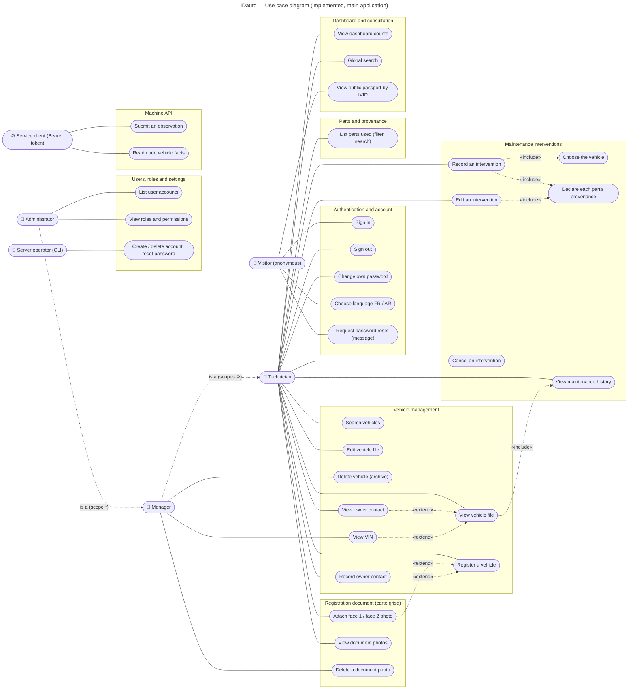

# 02 — Use case diagram

Source files:
- Mermaid: [`diagrams/use-case.mmd`](diagrams/use-case.mmd)
- PlantUML (standard UML notation): [`diagrams/use-case.puml`](diagrams/use-case.puml)

Scope: **implemented** functionality only. What is partial, planned or deprecated is listed in §4 and does not
appear in the diagram.

## 1. Diagram — IDauto use cases (implemented, main application)

**How to read the diagram:**
- Each actor is linked only to the use cases that **its own role** adds.
- The dotted « is a » arrows are actor generalisations:
  - a Manager can do everything a Technician can;
  - an Administrator can do everything a Manager can.
- This follows `reference/auth/principal.js`: the technician's 17 scopes are a strict subset of the manager's 24, and
  the administrator holds `*`.
- Mermaid has no native use-case notation. The ovals and dotted arrows imitate it; the PlantUML file uses the
  standard UML shapes.

## 2. Actors

| Actor | Kind | How the system recognises it | Source |
|---|---|---|---|
| Visitor | human, anonymous | no credential | `api.js` (`/public/*`, `/login`, public pages) |
| Technician | human | Better Auth session, `role = 'technician'`, `org_id` set | `auth/principal.js` `TECHNICIAN_SCOPES` |
| Manager | human | Better Auth session, `role = 'manager'`, `org_id` set | `auth/principal.js` `MANAGER_SCOPES` |
| Administrator | human | Better Auth session, `role = 'admin'` (no organisation) | `auth/principal.js` (`scopes: ['*']`) |
| Server operator | human, on the server shell | runs `node ops/auth-users.js` with database access | `ops/auth-users.js` |
| Service client | external system | `Authorization: Bearer` token listed in `IDAUTO_ADMIN_IDENTITIES` | `reference/identity.js` |

**Not shown as actors:**
- **Vehicle owner.** The owner's contact details are recorded by a workshop, but the owner never signs in.
- **Owner browser session** (`/session`). It is a console helper installed by an administrator and exposes two
  read routes, so it is an access mechanism, not a separate role.

## 3. Traceability — use case → route → scope

The required scope comes from `ALL_ROUTE_SCOPES` (`api.js`, `workspace-routes.js`, `v14-routes.js`, `v12-routes.js`).
A route absent from that table is admin-only.

| UC | Use case | Route(s) | Scope | Lowest role |
|---|---|---|---|---|
| UC1 | Sign in | `POST /api/auth/sign-in/email` (Better Auth, 5 per minute per client) | none | Visitor |
| UC2 | Sign out | `POST /api/auth/sign-out` | session | Technician |
| UC3 | Change own password | `POST /api/auth/change-password` (other sessions revoked) | session | Technician |
| UC4 | Choose language | `ida_lang` cookie, read by `i18n-serve.js` | none | Visitor |
| UC5 | Request password reset | « Mot de passe oublié » button → message only (`login-ui.js`); no route, no e-mail | none | Visitor |
| UC10 | Search vehicles | `GET /api/workspace/vehicles` | `vehicle:read` | Technician |
| UC11 | View vehicle file | `GET /api/vehicles/:ref/dossier` | `vehicle:read` | Technician |
| UC12 | Register a vehicle | `POST /api/vehicles/register` | `vehicle:write` | Technician |
| UC13 | Edit vehicle file | `PUT /api/vehicles/:ref/details` | `vehicle:write` | Technician |
| UC14 | Delete vehicle (archive) | `DELETE /api/vehicles/:ref` | `vehicle:delete` | Manager |
| UC15 | View owner contact | `GET /api/vehicles/:ref/owner` (every read audited) | `owner:read` | Technician |
| UC16 | Record owner contact | `PUT` / `DELETE /api/vehicles/:ref/owner` | `owner:write` | Technician |
| UC17 | View VIN | returned inside the dossier only with `vin:search`; each disclosure audited (`recordVinDisclosureAudit`) | `vin:search` | Manager |
| UC20 | Attach document photo | `PUT /api/vehicles/:ref/registration-document/:face` (+ `/thumbnail`) | `document:write` | Technician |
| UC21 | View document photos | `GET …/registration-document`, `GET …/:face/image`, `GET /api/workspace/documents` | `document:read` | Technician |
| UC22 | Delete a document photo | `DELETE /api/vehicles/:ref/registration-document/:face` | `document:delete` | Manager |
| UC30–32 | Record an intervention (vehicle, parts, provenance) | `POST /api/workspace/interventions` | `workshop:write` | Technician |
| UC33 | Edit an intervention | `PUT /api/workspace/interventions/:id` | `workshop:write` | Technician |
| UC34 | Cancel an intervention | `DELETE /api/workspace/interventions/:id` (status → cancelled) | `workshop:write` | Technician |
| UC35 | View maintenance history | part of the dossier; `GET /api/workspace/interventions` | `vehicle:read`, `workshop:read` | Technician |
| UC40 | List parts used | `GET /api/workspace/parts-used` | `workshop:read` | Technician |
| UC50 | View dashboard counts | `GET /api/workspace/overview`, `GET /api/notifications` | `vehicle:read` | Technician |
| UC51 | Global search | `GET /api/search` | `vehicle:read` | Technician |
| UC52 | View public passport | `GET /public/passport/:ivid` (rate-limited; plate lookup closed) | none | Visitor |
| UC60 | List user accounts | `GET /api/admin/accounts` | admin-only | Administrator |
| UC61 | View roles and permissions | `GET /api/admin/roles` | admin-only (absent from the scope table) | Administrator |
| UC62 | Create / delete account, reset password | `ops/auth-users.js create`, `delete`, `set-password`, `set-role`, `revoke-sessions` | shell access | Server operator |
| UC70 | Submit an observation | `POST /api/observations`, `POST /api/ingest/observations` | `observation:write` | Service client |
| UC71 | Read / add vehicle facts | `GET` / `POST /api/vehicles/:ref/facts` | `fact:read` / `fact:write` | Service client |

**Organisation scoping.** Every organisation principal is limited to rows of its own organisation, and this is
checked again in SQL. Two cases differ:
- Owner contacts and notes are private to the workshop that recorded them.
- A vehicle is shared between organisations; its intervention history is filtered per organisation.

## 4. Functionality left out of the diagram

| Functionality | Status | Why it is not drawn |
|---|---|---|
| Carte grise OCR (`…/registration-document/ocr`, `…/confirm`) | Deprecated | answers 410 unless `IDAUTO_CG_OCR_ENABLED=1` |
| Operator console pages (`/admin/*`: review queue, merge / split, quality, sources) | Implemented, outside the simplified menu | console-only. Its routes are admin-only (`POST /api/review/*`, `POST /api/vehicles/:ref/merge`, `/split`). It would double the diagram, so it is described in 04-logical-architecture. |
| Legacy workshop page `/atelier` (plate photo + in-browser OCR, V12 visits) | Implemented, outside the simplified menu | superseded by the intervention use cases above |
| Workshop orders, stock | Partial | tables and repository functions only |
| TecDoc catalogue lookup | Partial / not configured | no configuration on the production host |
| Camera capture, movements, consent, verifications | Planned | tables only, no code path |
| Self-service password reset by e-mail | Not implemented | no e-mail integration |

## 5. Uncertainties

- **UC4 (language).** The Visitor is linked to it because the switch exists on the sign-in and public pages.
  Signed-in users have it too, through inheritance from the shell.
- **UC62.** This is a server-shell action, not a web action. It is drawn so that account management is visible, and
  its actor is distinct from the web Administrator.
