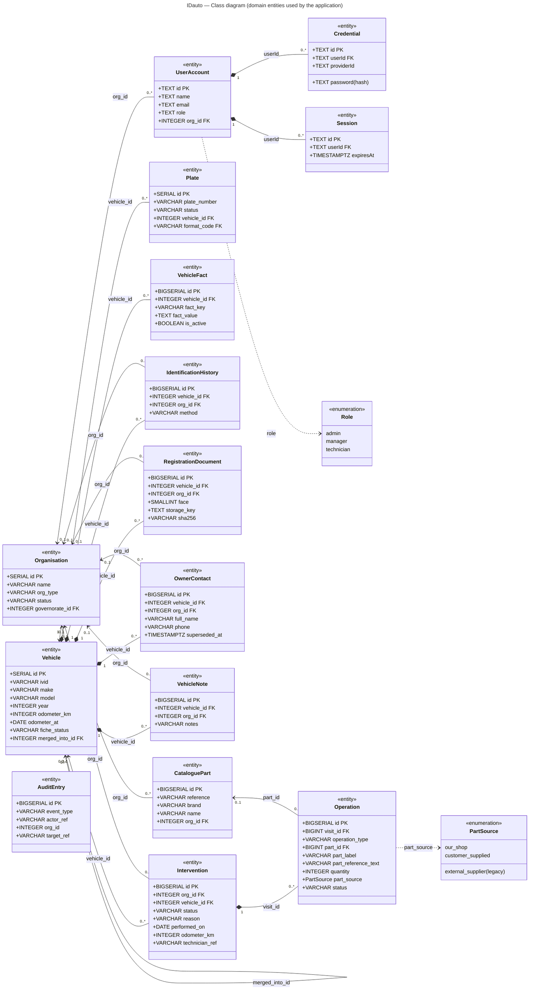
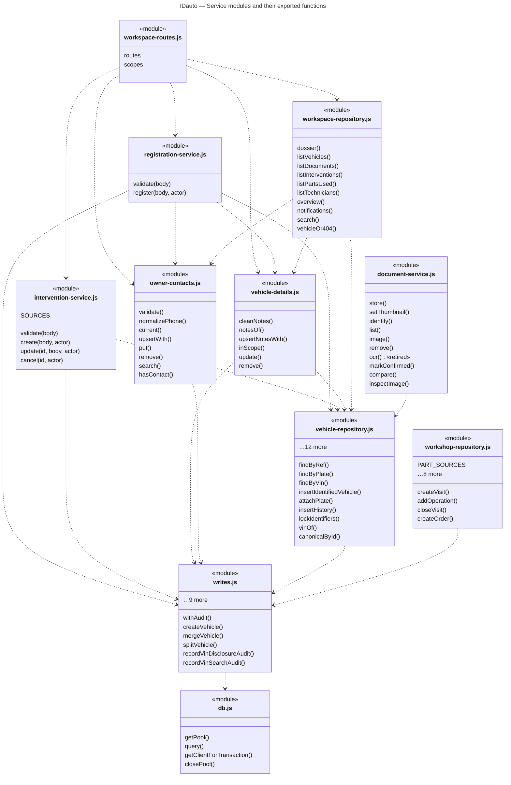

# 03 — Class diagram

Source files:
- Mermaid: [`diagrams/class-diagram.mmd`](diagrams/class-diagram.mmd)
- PlantUML: [`diagrams/class-diagram.puml`](diagrams/class-diagram.puml)

**What a "class" is here.** IDauto is written as CommonJS modules that export functions. It defines **no JavaScript
class, no ORM model and no TypeScript type** for its domain; rows travel as plain objects built from SQL results.
This document therefore gives two separate views, and does not mix them with the database tables:

- **View A — domain entities.** These are the conceptual classes the application reads and writes. Each one is
  backed by exactly one table, and §2 gives the mapping. Attribute names and types are copied from
  `database/schema.sql` and `database/migrations/*.sql`. Only attributes that the code uses are shown; the full
  column lists are in 06-data-model.
- **View B — service modules.** These are the code units and the functions they really export
  (`Object.keys(require(module))`).

## 1. View A — IDauto domain entities (used by the application)

**How to read the diagram:**

| Notation | Meaning |
|---|---|
| `*--` (composition) | The child row has a **NOT NULL** foreign key to the parent and has no meaning without it (contacts, notes, photos, facts, operations). |
| `<--` (association) | The foreign key is optional. The multiplicity on the parent side is `0..1` when the FK is nullable and `1` when it is NOT NULL. |
| `..>` to an «enumeration» | A CHECK-constrained column. `Role` is enforced by the CHECK `chk_auth_user_role` (migration `ida-v13-auth-session.sql`); `PartSource` by the CHECK on `part_source` (migration `ida-ui3-registration-maintenance.sql`). |

**Domain rules not visible as relationships:**
- **Vehicle deletion** archives the vehicle: `fiche_status = 'archived'`, its plates are cancelled and its VIN fact is
  deactivated. Nothing is physically deleted (`vehicle-details.js remove()`).
- **Only one active plate per plate number.** This is a partial unique index, `uidx_idauto_plates_number_active`.
- **Only one current owner contact per vehicle and workshop.** `uq_owner_contact_current` covers the rows where
  `superseded_at IS NULL`. A new contact supersedes the old one; the old one is kept.
- **One note per vehicle and workshop** (`uq_vehicle_notes_org`).
- **Cancelling an intervention** sets `status = 'cancelled'`. It is never a physical delete.
- **Part provenance.** `PartSource` has two values in the application: `our_shop` and `customer_supplied`.
  `external_supplier` is still accepted by the CHECK for older rows, but the application no longer offers it.
- **Every write is audited.** `AuditEntry` has no foreign key, on purpose: it records references (`actor_ref`,
  `target_ref`, `org_id`) as text and numbers so that the log survives deletions. Each row is written in the same
  transaction as the change it records (`writes.withAudit`).

## 2. Traceability — entity → table → code

| Entity | Table | Main code reading / writing it | Verified |
|---|---|---|---|
| Organisation | `idauto_organizations` | `intervention-service.orgOf`, `admin-repository`, `principal.js` (via `org_id`) | ✔ |
| UserAccount | `idauto_auth_user` | Better Auth (`auth/auth.js`), `ops/auth-users.js`, `workspace-repository.listTechnicians` | ✔ |
| Credential | `idauto_auth_account` | Better Auth (password hash, scrypt) | ✔ |
| Session | `idauto_auth_session` | Better Auth | ✔ |
| Vehicle | `idauto_vehicles` | `vehicle-repository`, `registration-service`, `vehicle-details`, `writes.createVehicle / mergeVehicle / splitVehicle` | ✔ |
| Plate | `idauto_plates` | `vehicle-repository.attachPlate / findByPlate`, `writes.createPlate` | ✔ |
| VehicleFact | `idauto_vehicle_facts` | `vehicle-repository.vinOf` (VIN is a fact), `writes.createFact / reviewFact` | ✔ |
| IdentificationHistory | `idauto_vehicle_identification_history` | `vehicle-repository.insertHistory / history` | ✔ |
| RegistrationDocument | `idauto_vehicle_documents` | `documents/document-repository`, `document-service.store / list / remove` | ✔ |
| OwnerContact | `idauto_vehicle_owner_contacts` | `owner-contacts.put / current / remove / search` | ✔ |
| VehicleNote | `idauto_vehicle_notes` | `vehicle-details.upsertNotesWith / notesOf` | ✔ |
| Intervention | `idauto_workshop_visits` | `intervention-service.create / update / cancel`, `workshop-repository.createVisit` | ✔ |
| Operation | `idauto_workshop_operations` | `intervention-service.insertParts`, `workshop-repository.addOperation` | ✔ |
| CataloguePart | `idauto_parts` | `parts/local-parts-catalog.js`, `workshop-repository` | ✔ |
| AuditEntry | `idauto_audit_log` | `writes.withAudit` and every `record*Audit` function | ✔ |

**Automatic check.** A script compared every attribute (name and SQL base type) with the parsed schema. It compared
every relationship with an enforced foreign key, and every parent-side multiplicity with the nullability of that
key. Result: **102 items checked, 0 differences** (see README §Validation).

**Left out of View A on purpose:**
- the 9 tables that no code path uses (planned);
- the observation / evidence / review tables, which are used by the machine API and the console;
- the reference tables (governorates, plate formats).

All of them are in 06-data-model, with their status.

## 3. View B — service modules (code units, real exports)

**How to read the diagram.**
- Each box is a file, not an instantiable class. The members are the names the file exports.
- The dashed arrows are `require()` dependencies, all read from the source.
- Every module that touches the database also requires `db.js` directly. Those arrows are left out to keep the
  diagram readable; only `writes ..> db` is drawn.
- `document-service` stores files through `document-storage.js` and its metadata through `document-repository.js`.
- `intervention-service` writes the visit and operation tables with its own SQL, inside `writes.withAudit`. It does
  not call `workshop-repository`, which serves the older `/atelier` workshop page (V12).

## 4. Uncertainties

- **Roles.** `Role` is stored as `TEXT` in `idauto_auth_user.role` and constrained by `chk_auth_user_role`. Do not
  confuse it with `idauto_user_roles` (`chk_user_role`: owner / admin / member / readonly): that table is
  schema-only and no code uses it.
- **Better Auth columns.** Better Auth owns the columns of the three auth tables. Only the columns IDauto reads, plus
  the `role` and `org_id` columns that IDauto adds, are drawn.
