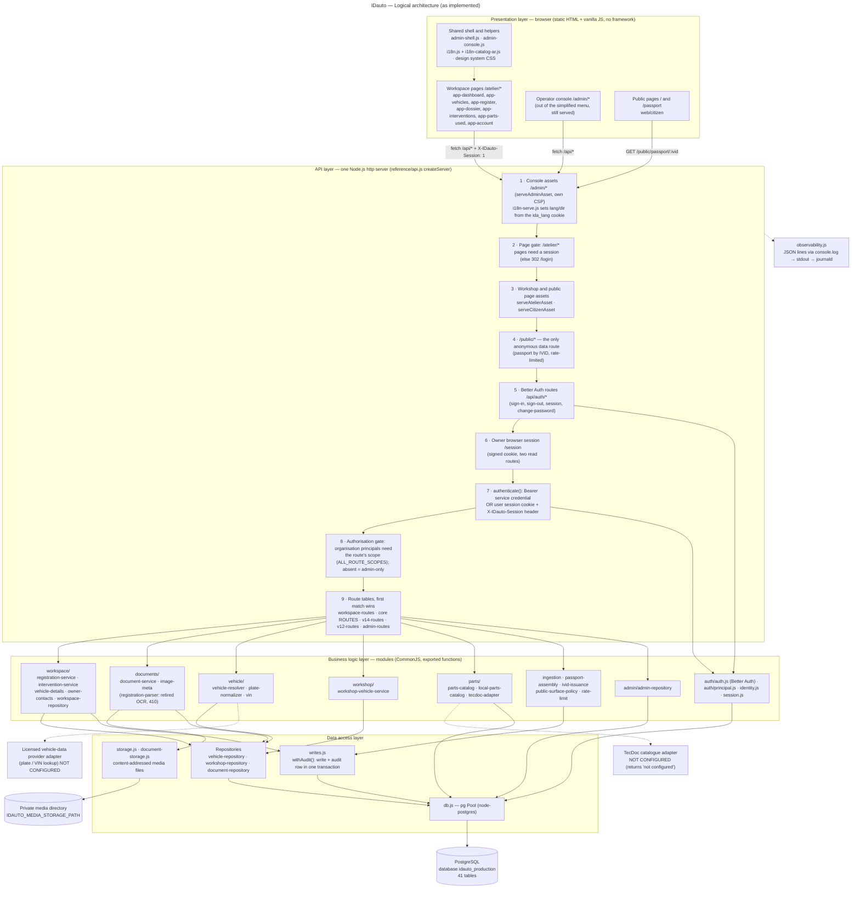
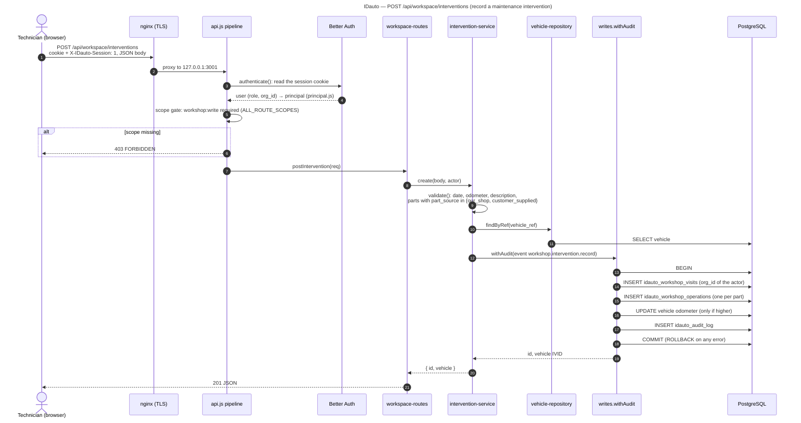

# 04 — Logical architecture

Source file: [`diagrams/logical-architecture.mmd`](diagrams/logical-architecture.mmd)

IDauto is a **layered monolith**: one Node.js process serves the pages, the static assets and the JSON API. There
is no web framework, no message broker, no cache server and no background worker.

## 1. Diagram — layers and request pipeline

**How to read the diagram.**
- The API layer is drawn **in the order a request crosses it**: the numbers 1 to 9 follow the order of the checks in
  `createServer()` (`reference/api.js`). The first step that answers ends the request.
- The business modules hold the rules (validation, organisation scoping, provenance values, archive instead of
  delete).
- Every write goes through `writes.withAudit()`, which wraps the change and its audit row in one transaction.
- Dotted arrows are optional or secondary paths:
  - the TecDoc and vehicle-data provider adapters, neither configured in production;
  - the logs;
  - the shared shell script loaded by every page.

## 2. Layers

| Layer | Contents | Rules it owns |
|---|---|---|
| Presentation | Static HTML pages built by `ops/ui/build-pages.py`; one script per page (`app-*.js`), the shared shell (`admin-shell.js`), console helpers, French / Arabic catalogue, design-system CSS | No business rule. Calls the API with `fetch` and the `X-IDauto-Session: 1` header. |
| API | `api.js` pipeline + route tables (`workspace-routes`, core `ROUTES`, `v14-routes`, `v12-routes`, `admin-routes`) | Body size, CSP and security headers, authentication, scope gate, rate limits, JSON errors |
| Business logic | `workspace/*`, `documents/*`, `vehicle/*`, `workshop/*`, `parts/*`, ingestion / passport / IVID modules, `admin/admin-repository` | Validation, organisation isolation, archive-only deletion, audit of sensitive reads (owner contact, VIN) |
| Data access | Repositories, `writes.js`, `db.js` (one `pg` pool), `storage.js` / `document-storage.js` | Transactions, audit rows, content-addressed file names |
| Data | PostgreSQL (41 tables, see 06-data-model), private media directory | Foreign keys, CHECKs, partial unique indexes |

## 3. Sequence — recording an intervention

This is the most complete write path of the simplified application. Every step below is in the code.

**How to read the diagram.**
- A validation error (400), an unknown vehicle (404) or a missing organisation (403) stops the flow before the
  transaction starts.
- An error inside the transaction rolls back the visit, its operations and the audit row together.
- `withAudit` refuses to run without an authenticated identity (401). An unattributed write is therefore impossible.
- Source: `workspace-routes.js postIntervention`, `intervention-service.js create`, `writes.js withAudit`.

## 4. Security boundaries

| Boundary | Mechanism | Source |
|---|---|---|
| Internet → host | nginx terminates TLS. The Node process binds `127.0.0.1` only. | `api.js` `listen(port, '127.0.0.1')`; nginx site |
| Anonymous → data | Only `/public/passport/:ivid` (IVID only, rate-limited, switchable in config). Plate lookup is closed. | `api.js`, `public-surface-policy.js` |
| Pages | `/atelier/*` pages redirect to `/login` without a session. | `api.js` page gate |
| API | No session (or Bearer token) → 401. Cookie requests also need the `X-IDauto-Session: 1` header, which protects against cross-site requests. | `api.js authenticate()` |
| Role | Route scope from `ALL_ROUTE_SCOPES`. A route absent from it is admin-only. | `api.js`, `principal.js` |
| Organisation | `org_id = $n` in every workspace query; owner contacts and notes are private per workshop | `workspace/*.js` |
| Sensitive reads | Owner contact read and VIN disclosure each write an audit row | `owner-contacts.js`, `writes.recordVinDisclosureAudit` |
| Media | Photos served only through authenticated routes, after an organisation check. No public URL. | `v14-routes.js`, `document-service.image` |
| Browser | Content-Security-Policy per page family, `X-Content-Type-Options`, frame denial | `api.js` asset servers |
| Brute force | Sign-in and change-password: 5 per minute per client | `auth/auth.js` rate-limit rules |

## 5. Cross-cutting concerns

- **Audit.** `idauto_audit_log` gets one row per write, in the same transaction. Sensitive reads are audited too.
- **Logging.** `observability.js` writes one JSON line per event (auth decisions, errors) to stdout, and the
  systemd journal keeps it. There is no external log or metrics service.
- **Internationalisation.** Pages are written in French. `i18n-serve.js` sets `lang` / `dir` on the server from the
  `ida_lang` cookie; `i18n.js` translates in the browser from `i18n-catalog-ar.js`.
- **Configuration.**
  - Environment variables: `IDAUTO_DB_*`, `IDAUTO_MEDIA_STORAGE_PATH`, `IDAUTO_ADMIN_IDENTITIES`,
    `IDAUTO_AUTH_SECRET`, `IDAUTO_AUTH_BASE_URL`, `IDAUTO_SESSION_SECRET`, `IDAUTO_PUBLIC_RESOLUTION_CONFIG_PATH`.
  - Optional variables, **not set in production**: `IDAUTO_TECDOC_*`, `IDAUTO_VEHICLE_PROVIDER_*`,
    `IDAUTO_CG_OCR_ENABLED`, `IDAUTO_ALLOW_MOCK_PROVIDERS`.
  - Also read: `config/idauto.example.json` for plate formats. The public-resolution switch comes from the file named by
    `IDAUTO_PUBLIC_RESOLUTION_CONFIG_PATH`.
  - Only variable **names** are documented here.

## 6. Traceability

| Diagram element | Code |
|---|---|
| Steps 1 to 9 | `reference/api.js` `createServer()`: `serveAdminAsset`, page gate, `serveAtelierAsset`, `serveCitizenAsset`, `/public/`, `auth.handler`, `/session`, `authenticate()`, scope gate, `ALL_ROUTES` loop |
| Route order | `ALL_ROUTES = workspace.routes.concat(ROUTES, v14.routes, v12.routes, adminConsole.routes)` |
| workspace/ | `reference/workspace/*.js` |
| documents/ | `reference/documents/*.js` |
| vehicle/ | `reference/vehicle/*.js` |
| workshop/ | `reference/workshop/*.js` |
| parts/ | `reference/parts/*.js` (used by `v12-routes.js`) |
| Repositories | `vehicle/vehicle-repository.js`, `workshop/workshop-repository.js`, `documents/document-repository.js` |
| writes.js, db.js, storage.js | `reference/writes.js`, `reference/db.js`, `reference/storage.js`, `documents/document-storage.js` |
| TecDoc | `reference/parts/tecdoc-adapter.js` |
| Vehicle-data provider (not configured) | `reference/vehicle/providers/http-vehicle-provider.js` |
| Logs | `reference/observability.js` |

## 7. Uncertainties

- The operator console (`/admin/*`) is still served and reachable by administrators, although it has left the
  simplified menu. This document treats it as implemented. Whether it is meant to stay is a product decision,
  not an architecture fact.
