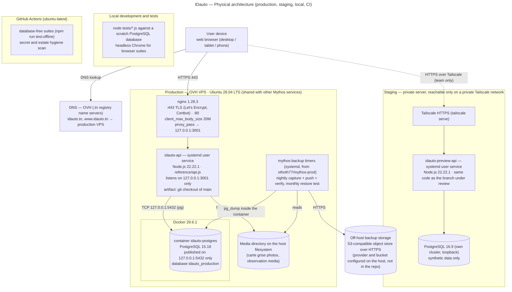

# 05 — Physical architecture

Source file: [`diagrams/physical-architecture.mmd`](diagrams/physical-architecture.mmd)

**How this was confirmed.** The production values come from read-only checks on the production host, made on
2026-11-10: service status, program versions, listening sockets, the nginx site, the container list and a database
table count. Configuration was read as variable **names and counts** only, never as values.

**Deliberately omitted:**
- IP addresses, private host names, file-system paths;
- account names, tokens and keys;
- the backup bucket and its provider credentials.

## 1. Diagram — deployment nodes

**How to read the diagram.**
- Solid arrows are network or file paths used in normal operation.
- The dotted arrow is the private staging access, which only team members on the private network can use.
- Only nginx is reachable from the Internet. The Node process and PostgreSQL listen on the loopback interface only.

## 2. Production

| Node | What runs there | Confirmed facts |
|---|---|---|
| DNS | OVH name servers for `idauto.tn` | `idauto.tn` and `www.idauto.tn` resolve to the production host |
| Production host | OVH VPS, Ubuntu 26.04 LTS. Shared with other services of the owner (Mythos), so its disk and memory are shared. | `lsb_release`, `systemctl` |
| nginx 1.28.3 | TLS on 443 (Let's Encrypt via Certbot), HTTP on 80, `client_max_body_size 20M`, reverse proxy to the API on loopback | `nginx -v`, site configuration |
| idauto-api | systemd **user** service, Node.js 22.22.1, runs `reference/api.js` from a git checkout of `main`; restarted by systemd | `systemctl --user status`, `node --version`, `ss -ltn` |
| PostgreSQL 15.18 | Docker 29.6.1 container `idauto-postgres`, published on loopback only; database **`idauto_production`** with the 41 tables of the repository and no other table | `SELECT version()`, `docker ps`, table-list comparison |
| Media directory | Host file system; the content-addressed carte grise photos and observation media | `IDAUTO_MEDIA_STORAGE_PATH` is set (value not shown) |
| Backup timers | systemd timers from the `othoth77/mythos-prod` repository (`ops/backup/mythos-backup-run.sh`), the IDauto pipeline only. `mythos-backup` (daily 03:30 UTC) captures `idauto_production` and the media and pushes them off-host. `mythos-backup-verify` (daily 15:00 UTC) checks the push. `mythos-restore-test` (1st of each month, 05:00 UTC) runs a restore test. The host's other backup timers belong to other services. | `systemctl list-timers`, `systemctl show … ExecStart` |
| Off-host storage | S3-compatible object store over HTTPS, written by `ops/offhost-backup.js` | adapter `ops/adapters/s3-compatible.js` |

**Request path.** Browser → DNS → nginx :443 (TLS) → `127.0.0.1` API port → `pg` pool → PostgreSQL in Docker.
The media files are read and written on the host file system.

**Not present in production:**
- no load balancer and no second application instance;
- no CDN, no cache server, no message queue;
- no external log or metrics service: logs go to the systemd journal;
- no TecDoc or vehicle-data provider configuration;
- no e-mail service.

## 3. Staging (preview)

| Node | Facts |
|---|---|
| Access | Private server, reachable only over a private Tailscale network (`tailscale serve`, HTTPS). Not exposed to the Internet. |
| Application | `idauto-preview-api`, systemd user service, Node.js 22.22.1, runs the branch under review |
| Database | PostgreSQL 16.9, its own cluster on loopback, **synthetic data only** |

Staging is where the owner accepts a change before it is deployed. Its PostgreSQL major version (16) differs from
production (15). See §7.

## 4. Local development and CI

| Environment | Facts |
|---|---|
| Local | `node tests/*.js` against a scratch PostgreSQL database; headless Chrome for the browser suites (`ida-ui-browser`) |
| CI | GitHub Actions on `ubuntu-latest`, Node 22 (`.github/workflows/ci.yml`). It runs two jobs: the database-free suites (`npm run test:offline`, 16 files) and the « secret and estate hygiene » job (`.github/scripts/secret_scan.sh`). |

## 5. Deployment procedure (as practised)

1. Update the git checkout on the production host to the merged `main` commit.
2. Apply any new migration explicitly with `psql -d idauto_production`.
3. Restart the user service.
4. Run an acceptance check on `https://idauto.tn`.

Rollback means checking out the previous commit and restarting. There is no build step and no container image for the
application.

## 6. Traceability

| Diagram node | Evidence |
|---|---|
| DNS (OVH) | `dig NS idauto.tn` (OVH name servers) |
| nginx 1.28.3, ports, TLS, 20M | `nginx -v`; nginx site for `idauto.tn`; certificate issuer Let's Encrypt |
| idauto-api, Node 22.22.1, loopback | `systemctl --user`, `node --version`, `ss -ltn`, `api.js listen(port, '127.0.0.1')` |
| Docker 29.6.1, PostgreSQL 15.18, `idauto_production`, 41 tables | `docker --version`, `docker ps`, `SELECT version()`, `information_schema.tables` compared with the repository schema |
| Media directory | `reference/storage.js`, `documents/document-storage.js`; variable present |
| Backup timers | `systemctl list-timers` and `ExecStart` of `mythos-backup`, `mythos-backup-verify`, `mythos-restore-test`; `othoth77/mythos-prod` `ops/backup/mythos-backup-run.sh` |
| Off-host storage | `ops/offhost-backup.js`, `ops/adapters/s3-compatible.js` |
| Staging | `systemctl --user status idauto-preview-api`, PostgreSQL 16.9 binary, Tailscale serve |
| CI | `.github/workflows/ci.yml` |

## 7. Uncertainties

- **Off-host storage provider.** The repository only says "S3-compatible (suitable for Cloudflare R2)". The provider
  in use is configured on the host and was not read, so the diagram does not name it.
- **Backup scheduling.** It belongs to another repository (`othoth77/mythos-prod`). Its exact schedule may change
  without a change in this repository.
- **PostgreSQL versions.** Staging (16.9) and production (15.18) differ by one major version. This audit did not check
  whether any migration depends on a version-16 feature.
- **Shared host.** The production host also runs other services, which compete for disk and memory. Their names are
  not documented here.
