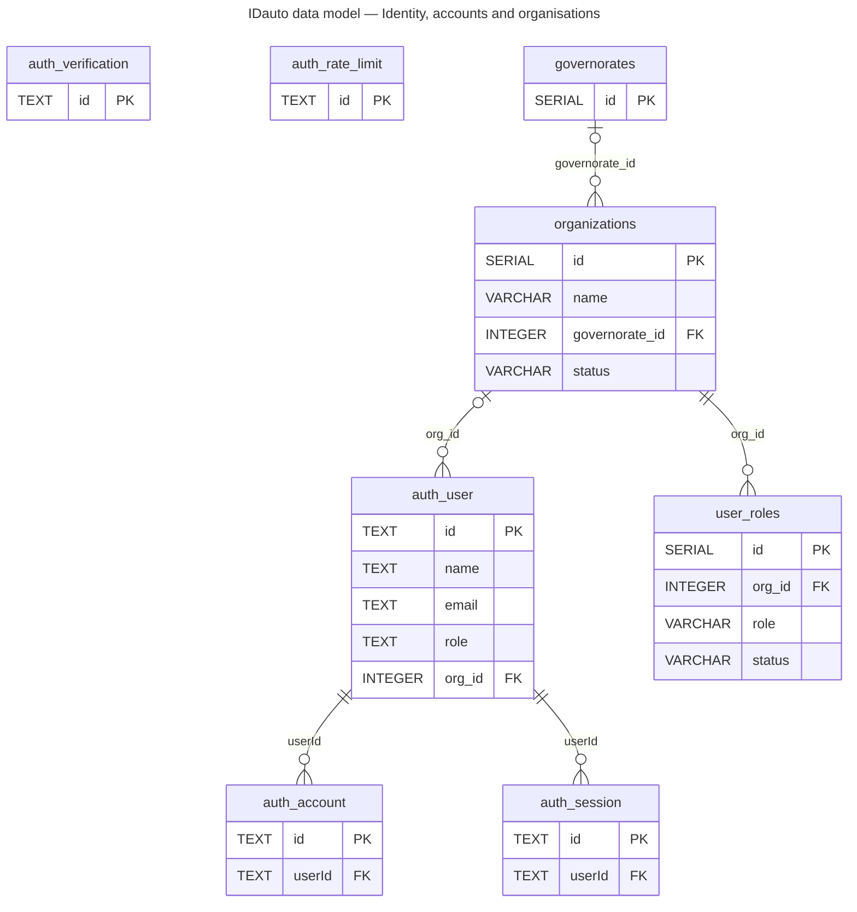
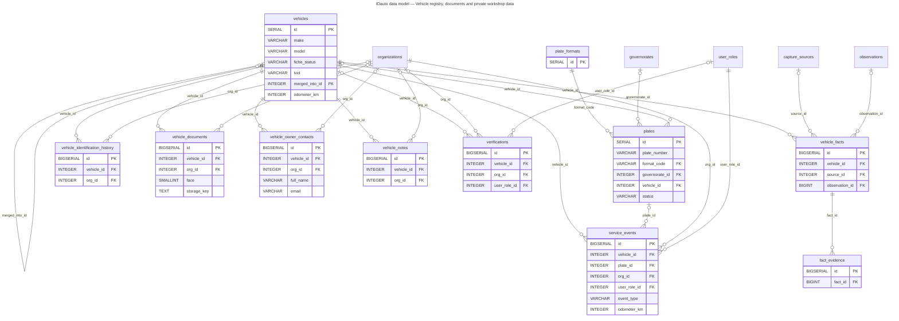
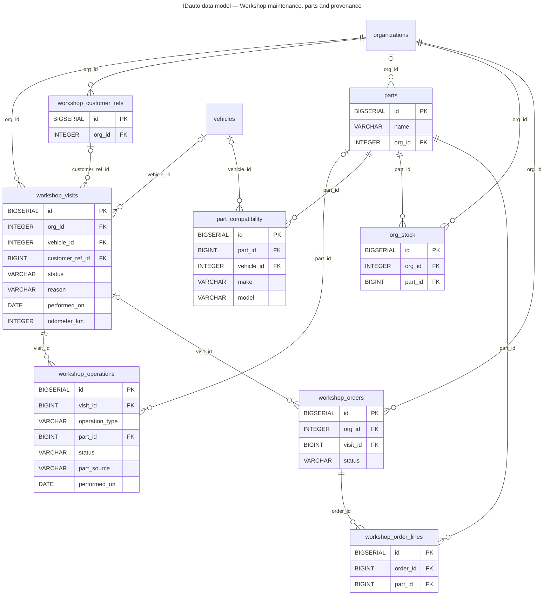
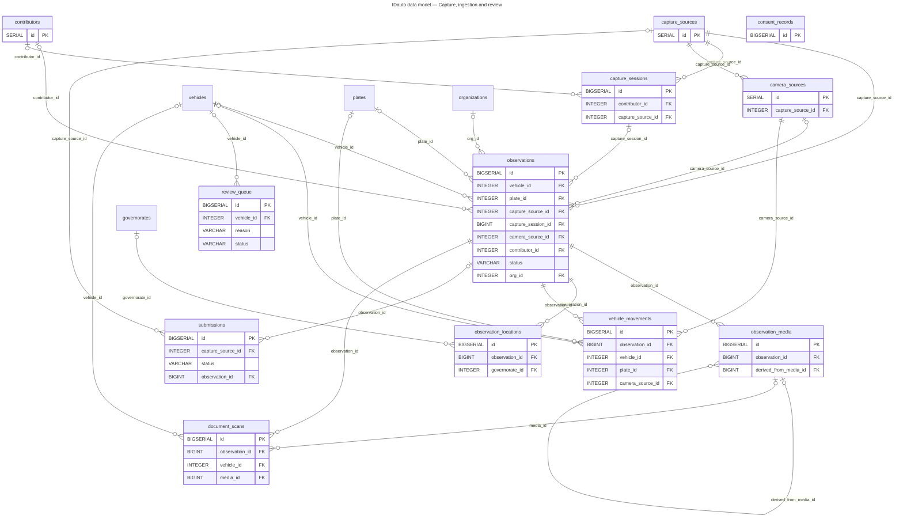
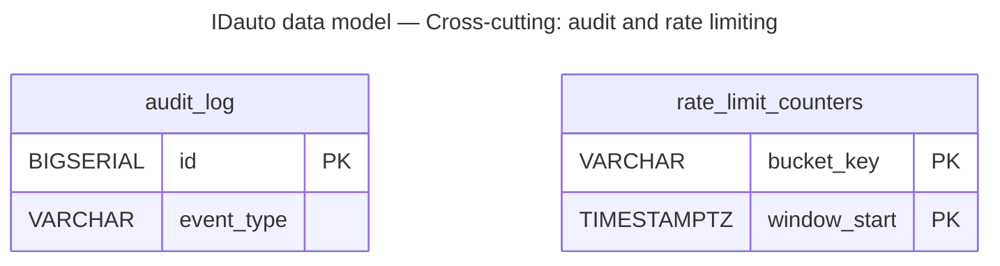

# 06 — Data model

**Source:** `database/schema.sql` and the migrations in `database/migrations/`, applied in the order of `docs/DATABASE.md`.
This page is **generated** from the SQL. Nothing here is drawn by hand.

**What is shown:**
- **Table count:** 41 tables, all in the `public` schema of the `idauto_production` database. The target schemas described in `docs/ARCHITECTURE.md` §2 are not implemented.
- **Usage:** a table marked « schema only » is created by the schema but read or written by no code path in `reference/` or `ops/`.
- **Foreign keys:** only constraints enforced by PostgreSQL (`REFERENCES`) are drawn. A relation documented only as a comment in `schema.sql` is listed separately.
- **Multiplicities:** `||` marks a mandatory foreign key (NOT NULL); `|o` marks an optional one.
- **Diagram columns:** each ER diagram shows the keys and the main business columns; the tables below list every column.

## Identity, accounts and organisations

| Table | Status | Primary key | Foreign keys (enforced) | Defined in |
|---|---|---|---|---|
| `idauto_auth_user` | used by code | `id` | `org_id` → `idauto_organizations` | `database/migrations/ida-v13-auth-session.sql` |
| `idauto_auth_account` | used by code | `id` | `userId` → `idauto_auth_user` | `database/migrations/ida-v13-auth-session.sql` |
| `idauto_auth_session` | used by code | `id` | `userId` → `idauto_auth_user` | `database/migrations/ida-v13-auth-session.sql` |
| `idauto_auth_verification` | used by code | `id` | — | `database/migrations/ida-v13-auth-session.sql` |
| `idauto_auth_rate_limit` | used by code | `id` | — | `database/migrations/ida-v13-auth-session.sql` |
| `idauto_organizations` | used by code | `id` | `governorate_id` → `idauto_governorates` | `database/schema.sql` |
| `idauto_user_roles` | **schema only** (no code path) | `id` | `org_id` → `idauto_organizations` | `database/schema.sql` |
| `idauto_governorates` | used by code | `id` | — | `database/schema.sql` |

<code>idauto_auth_user</code>: 9 columns

| Column | Type | NOT NULL |
|---|---|---|
| `id` | `TEXT` | yes |
| `name` | `TEXT` | yes |
| `email` | `TEXT` | yes |
| `emailVerified` | `BOOLEAN` | yes |
| `image` | `TEXT` |  |
| `createdAt` | `TIMESTAMPTZ` | yes |
| `updatedAt` | `TIMESTAMPTZ` | yes |
| `role` | `TEXT` | yes |
| `org_id` | `INTEGER` |  |

<code>idauto_auth_account</code>: 14 columns

| Column | Type | NOT NULL |
|---|---|---|
| `id` | `TEXT` | yes |
| `issuer` | `TEXT` | yes |
| `accountId` | `TEXT` | yes |
| `providerId` | `TEXT` | yes |
| `userId` | `TEXT` | yes |
| `accessToken` | `TEXT` |  |
| `refreshToken` | `TEXT` |  |
| `idToken` | `TEXT` |  |
| `accessTokenExpiresAt` | `TIMESTAMPTZ` |  |
| `refreshTokenExpiresAt` | `TIMESTAMPTZ` |  |
| `scope` | `TEXT` |  |
| `password` | `TEXT` |  |
| `createdAt` | `TIMESTAMPTZ` | yes |
| `updatedAt` | `TIMESTAMPTZ` | yes |

<code>idauto_auth_session</code>: 8 columns

| Column | Type | NOT NULL |
|---|---|---|
| `id` | `TEXT` | yes |
| `expiresAt` | `TIMESTAMPTZ` | yes |
| `token` | `TEXT` | yes |
| `createdAt` | `TIMESTAMPTZ` | yes |
| `updatedAt` | `TIMESTAMPTZ` | yes |
| `ipAddress` | `TEXT` |  |
| `userAgent` | `TEXT` |  |
| `userId` | `TEXT` | yes |

<code>idauto_auth_verification</code>: 6 columns

| Column | Type | NOT NULL |
|---|---|---|
| `id` | `TEXT` | yes |
| `identifier` | `TEXT` | yes |
| `value` | `TEXT` | yes |
| `expiresAt` | `TIMESTAMPTZ` | yes |
| `createdAt` | `TIMESTAMPTZ` | yes |
| `updatedAt` | `TIMESTAMPTZ` | yes |

<code>idauto_auth_rate_limit</code>: 4 columns

| Column | Type | NOT NULL |
|---|---|---|
| `id` | `TEXT` | yes |
| `key` | `TEXT` | yes |
| `count` | `INTEGER` | yes |
| `lastRequest` | `BIGINT` | yes |

<code>idauto_organizations</code>: 13 columns

| Column | Type | NOT NULL |
|---|---|---|
| `id` | `SERIAL` | yes |
| `name` | `VARCHAR(200)` | yes |
| `org_type` | `VARCHAR(30)` | yes |
| `subscription_tier` | `VARCHAR(20)` | yes |
| `tax_id` | `VARCHAR(30)` |  |
| `address_city` | `VARCHAR(80)` |  |
| `governorate_id` | `INTEGER` |  |
| `contact_email` | `VARCHAR(200)` |  |
| `status` | `VARCHAR(20)` | yes |
| `verified_at` | `TIMESTAMPTZ` |  |
| `is_fixpert_pilot` | `BOOLEAN` | yes |
| `created_at` | `TIMESTAMPTZ` | yes |
| `updated_at` | `TIMESTAMPTZ` | yes |

<code>idauto_user_roles</code>: 11 columns

| Column | Type | NOT NULL |
|---|---|---|
| `id` | `SERIAL` | yes |
| `mythos_user_id` | `VARCHAR(64)` | yes |
| `org_id` | `INTEGER` | yes |
| `role` | `VARCHAR(30)` | yes |
| `status` | `VARCHAR(20)` | yes |
| `granted_at` | `TIMESTAMPTZ` | yes |
| `granted_by` | `VARCHAR(64)` |  |
| `revoked_at` | `TIMESTAMPTZ` |  |
| `revoked_by` | `VARCHAR(64)` |  |
| `created_at` | `TIMESTAMPTZ` | yes |
| `updated_at` | `TIMESTAMPTZ` | yes |

<code>idauto_governorates</code>: 6 columns

| Column | Type | NOT NULL |
|---|---|---|
| `id` | `SERIAL` | yes |
| `code` | `VARCHAR(4)` | yes |
| `name_fr` | `VARCHAR(80)` | yes |
| `name_ar` | `VARCHAR(80)` |  |
| `region_fr` | `VARCHAR(80)` |  |
| `active` | `BOOLEAN` | yes |

## Vehicle registry, documents and private workshop data

| Table | Status | Primary key | Foreign keys (enforced) | Defined in |
|---|---|---|---|---|
| `idauto_vehicles` | used by code | `id` | `merged_into_id` → `idauto_vehicles` | `database/schema.sql` |
| `idauto_plates` | used by code | `id` | `format_code` → `idauto_plate_formats`, `governorate_id` → `idauto_governorates`, `vehicle_id` → `idauto_vehicles` | `database/schema.sql` |
| `idauto_plate_formats` | used by code | `id` | — | `database/schema.sql` |
| `idauto_vehicle_facts` | used by code | `id` | `vehicle_id` → `idauto_vehicles`, `source_id` → `idauto_capture_sources`, `observation_id` → `idauto_observations` | `database/schema.sql` |
| `idauto_fact_evidence` | used by code | `id` | `fact_id` → `idauto_vehicle_facts` | `database/schema.sql` |
| `idauto_vehicle_identification_history` | used by code | `id` | `vehicle_id` → `idauto_vehicles`, `org_id` → `idauto_organizations` | `database/migrations/ida-v12-vehicle-identification.sql` |
| `idauto_vehicle_documents` | used by code | `id` | `vehicle_id` → `idauto_vehicles`, `org_id` → `idauto_organizations` | `database/migrations/ida-v14-registration-document.sql` |
| `idauto_vehicle_owner_contacts` | used by code | `id` | `vehicle_id` → `idauto_vehicles`, `org_id` → `idauto_organizations` | `database/migrations/ida-ui3-registration-maintenance.sql` |
| `idauto_vehicle_notes` | used by code | `id` | `vehicle_id` → `idauto_vehicles`, `org_id` → `idauto_organizations` | `database/migrations/ida-ui4-simplification.sql` |
| `idauto_verifications` | **schema only** (no code path) | `id` | `vehicle_id` → `idauto_vehicles`, `org_id` → `idauto_organizations`, `user_role_id` → `idauto_user_roles` | `database/schema.sql` |
| `idauto_service_events` | used by code | `id` | `vehicle_id` → `idauto_vehicles`, `plate_id` → `idauto_plates`, `org_id` → `idauto_organizations`, `user_role_id` → `idauto_user_roles` | `database/schema.sql` |

<code>idauto_vehicles</code>: 36 columns

| Column | Type | NOT NULL |
|---|---|---|
| `id` | `SERIAL` | yes |
| `internal_ref` | `VARCHAR(40)` | yes |
| `make` | `VARCHAR(80)` |  |
| `model` | `VARCHAR(80)` |  |
| `variant` | `VARCHAR(80)` |  |
| `year` | `INTEGER` |  |
| `body_type` | `VARCHAR(40)` |  |
| `fuel_type` | `VARCHAR(20)` |  |
| `colour` | `VARCHAR(40)` |  |
| `seats` | `SMALLINT` |  |
| `gross_weight_kg` | `INTEGER` |  |
| `engine_cc` | `INTEGER` |  |
| `category_code` | `VARCHAR(10)` |  |
| `fiche_status` | `VARCHAR(20)` | yes |
| `first_seen_at` | `TIMESTAMPTZ` | yes |
| `last_seen_at` | `TIMESTAMPTZ` | yes |
| `observation_count` | `INTEGER` | yes |
| `created_at` | `TIMESTAMPTZ` | yes |
| `updated_at` | `TIMESTAMPTZ` | yes |
| `ivid` | `VARCHAR(40)` |  |
| `merged_into_id` | `INTEGER` |  |
| `pre_merge_status` | `VARCHAR(20)` |  |
| `motorisation` | `VARCHAR(80)` |  |
| `engine_code` | `VARCHAR(30)` |  |
| `year_from` | `SMALLINT` |  |
| `year_to` | `SMALLINT` |  |
| `tecdoc_car_id` | `INTEGER` |  |
| `identification_source` | `VARCHAR(40)` |  |
| `identification_source_at` | `TIMESTAMPTZ` |  |
| `identification_confidence` | `REAL` |  |
| `identification_verified` | `BOOLEAN` | yes |
| `identification_verified_by` | `VARCHAR(64)` |  |
| `identification_verified_at` | `TIMESTAMPTZ` |  |
| `identification_method` | `VARCHAR(40)` |  |
| `odometer_km` | `INTEGER` |  |
| `odometer_at` | `DATE` |  |

<code>idauto_plates</code>: 11 columns

| Column | Type | NOT NULL |
|---|---|---|
| `id` | `SERIAL` | yes |
| `plate_number` | `VARCHAR(20)` | yes |
| `plate_raw` | `VARCHAR(30)` |  |
| `format_code` | `VARCHAR(20)` | yes |
| `governorate_id` | `INTEGER` |  |
| `vehicle_id` | `INTEGER` |  |
| `status` | `VARCHAR(20)` | yes |
| `valid_from` | `DATE` |  |
| `valid_until` | `DATE` |  |
| `created_at` | `TIMESTAMPTZ` | yes |
| `updated_at` | `TIMESTAMPTZ` | yes |

<code>idauto_plate_formats</code>: 13 columns

| Column | Type | NOT NULL |
|---|---|---|
| `id` | `SERIAL` | yes |
| `code` | `VARCHAR(20)` | yes |
| `name_fr` | `VARCHAR(100)` | yes |
| `name_ar` | `VARCHAR(100)` |  |
| `pattern` | `TEXT` | yes |
| `example` | `VARCHAR(30)` |  |
| `introduced_year` | `INTEGER` |  |
| `active` | `BOOLEAN` | yes |
| `captures_json` | `TEXT` |  |
| `notes` | `TEXT` |  |
| `verified` | `BOOLEAN` | yes |
| `created_at` | `TIMESTAMPTZ` | yes |
| `updated_at` | `TIMESTAMPTZ` | yes |

<code>idauto_vehicle_facts</code>: 16 columns

| Column | Type | NOT NULL |
|---|---|---|
| `id` | `BIGSERIAL` | yes |
| `vehicle_id` | `INTEGER` | yes |
| `fact_key` | `VARCHAR(50)` | yes |
| `fact_value` | `TEXT` | yes |
| `fact_value_normalized` | `TEXT` |  |
| `source_id` | `INTEGER` |  |
| `observation_id` | `BIGINT` |  |
| `confidence_score` | `REAL` | yes |
| `verification_status` | `VARCHAR(20)` | yes |
| `access_scope` | `VARCHAR(20)` | yes |
| `is_active` | `BOOLEAN` | yes |
| `first_seen_at` | `TIMESTAMPTZ` | yes |
| `last_seen_at` | `TIMESTAMPTZ` | yes |
| `validated_by` | `VARCHAR(64)` |  |
| `validated_at` | `TIMESTAMPTZ` |  |
| `created_at` | `TIMESTAMPTZ` | yes |

<code>idauto_fact_evidence</code>: 6 columns

| Column | Type | NOT NULL |
|---|---|---|
| `id` | `BIGSERIAL` | yes |
| `fact_id` | `BIGINT` | yes |
| `evidence_type` | `VARCHAR(30)` | yes |
| `evidence_ref` | `VARCHAR(64)` |  |
| `weight` | `REAL` | yes |
| `created_at` | `TIMESTAMPTZ` | yes |

<code>idauto_vehicle_identification_history</code>: 12 columns

| Column | Type | NOT NULL |
|---|---|---|
| `id` | `BIGSERIAL` | yes |
| `vehicle_id` | `INTEGER` | yes |
| `changed_at` | `TIMESTAMPTZ` | yes |
| `actor_type` | `VARCHAR(20)` | yes |
| `actor_ref` | `VARCHAR(64)` |  |
| `org_id` | `INTEGER` |  |
| `action` | `VARCHAR(30)` | yes |
| `method` | `VARCHAR(40)` |  |
| `source` | `VARCHAR(40)` |  |
| `confidence` | `REAL` |  |
| `previous` | `JSONB` |  |
| `next` | `JSONB` |  |

<code>idauto_vehicle_documents</code>: 21 columns

| Column | Type | NOT NULL |
|---|---|---|
| `id` | `BIGSERIAL` | yes |
| `vehicle_id` | `INTEGER` | yes |
| `org_id` | `INTEGER` |  |
| `document_type` | `VARCHAR(30)` | yes |
| `face` | `SMALLINT` | yes |
| `storage_key` | `TEXT` | yes |
| `thumb_storage_key` | `TEXT` |  |
| `mime_type` | `VARCHAR(50)` | yes |
| `byte_size` | `INTEGER` | yes |
| `width` | `INTEGER` | yes |
| `height` | `INTEGER` | yes |
| `sha256` | `VARCHAR(64)` | yes |
| `original_byte_size` | `INTEGER` |  |
| `capture_meta` | `JSONB` |  |
| `ocr_status` | `VARCHAR(20)` | yes |
| `ocr_confidence` | `REAL` |  |
| `ocr_fields` | `JSONB` |  |
| `ocr_at` | `TIMESTAMPTZ` |  |
| `created_by` | `VARCHAR(64)` | yes |
| `created_at` | `TIMESTAMPTZ` | yes |
| `updated_at` | `TIMESTAMPTZ` | yes |

<code>idauto_vehicle_owner_contacts</code>: 13 columns

| Column | Type | NOT NULL |
|---|---|---|
| `id` | `BIGSERIAL` | yes |
| `vehicle_id` | `INTEGER` | yes |
| `org_id` | `INTEGER` |  |
| `full_name` | `VARCHAR(120)` | yes |
| `phone` | `VARCHAR(30)` |  |
| `phone_normalized` | `VARCHAR(20)` |  |
| `email` | `VARCHAR(160)` |  |
| `address` | `VARCHAR(240)` |  |
| `notes` | `VARCHAR(300)` |  |
| `created_by` | `VARCHAR(80)` | yes |
| `created_at` | `TIMESTAMPTZ` | yes |
| `superseded_at` | `TIMESTAMPTZ` |  |
| `superseded_by` | `VARCHAR(80)` |  |

<code>idauto_vehicle_notes</code>: 6 columns

| Column | Type | NOT NULL |
|---|---|---|
| `id` | `BIGSERIAL` | yes |
| `vehicle_id` | `INTEGER` | yes |
| `org_id` | `INTEGER` |  |
| `notes` | `VARCHAR(500)` | yes |
| `updated_by` | `VARCHAR(80)` | yes |
| `updated_at` | `TIMESTAMPTZ` | yes |

<code>idauto_verifications</code>: 13 columns

| Column | Type | NOT NULL |
|---|---|---|
| `id` | `BIGSERIAL` | yes |
| `plate_queried` | `VARCHAR(30)` | yes |
| `plate_normalised` | `VARCHAR(20)` |  |
| `result_status` | `VARCHAR(20)` | yes |
| `format_code` | `VARCHAR(20)` |  |
| `vehicle_id` | `INTEGER` |  |
| `caller_type` | `VARCHAR(20)` | yes |
| `org_id` | `INTEGER` |  |
| `user_role_id` | `INTEGER` |  |
| `ip_hash` | `VARCHAR(64)` |  |
| `user_agent_hash` | `VARCHAR(64)` |  |
| `response_ms` | `INTEGER` |  |
| `created_at` | `TIMESTAMPTZ` | yes |

<code>idauto_service_events</code>: 15 columns

| Column | Type | NOT NULL |
|---|---|---|
| `id` | `BIGSERIAL` | yes |
| `vehicle_id` | `INTEGER` | yes |
| `plate_id` | `INTEGER` |  |
| `org_id` | `INTEGER` | yes |
| `user_role_id` | `INTEGER` | yes |
| `event_type` | `VARCHAR(40)` | yes |
| `event_date` | `DATE` | yes |
| `odometer_km` | `INTEGER` |  |
| `description` | `TEXT` |  |
| `outcome` | `VARCHAR(30)` |  |
| `next_service_due` | `DATE` |  |
| `is_public` | `BOOLEAN` | yes |
| `source_ref` | `TEXT` |  |
| `created_at` | `TIMESTAMPTZ` | yes |
| `updated_at` | `TIMESTAMPTZ` | yes |

## Workshop maintenance, parts and provenance

| Table | Status | Primary key | Foreign keys (enforced) | Defined in |
|---|---|---|---|---|
| `idauto_workshop_visits` | used by code | `id` | `org_id` → `idauto_organizations`, `vehicle_id` → `idauto_vehicles`, `customer_ref_id` → `idauto_workshop_customer_refs` | `database/migrations/ida-v12-vehicle-identification.sql` |
| `idauto_workshop_operations` | used by code | `id` | `visit_id` → `idauto_workshop_visits`, `part_id` → `idauto_parts` | `database/migrations/ida-v12-vehicle-identification.sql` |
| `idauto_workshop_customer_refs` | used by code | `id` | `org_id` → `idauto_organizations` | `database/migrations/ida-v12-vehicle-identification.sql` |
| `idauto_parts` | used by code | `id` | `org_id` → `idauto_organizations` | `database/migrations/ida-v12-vehicle-identification.sql` |
| `idauto_part_compatibility` | used by code | `id` | `part_id` → `idauto_parts`, `vehicle_id` → `idauto_vehicles` | `database/migrations/ida-v12-vehicle-identification.sql` |
| `idauto_org_stock` | used by code | `id` | `org_id` → `idauto_organizations`, `part_id` → `idauto_parts` | `database/migrations/ida-v12-vehicle-identification.sql` |
| `idauto_workshop_orders` | used by code | `id` | `org_id` → `idauto_organizations`, `visit_id` → `idauto_workshop_visits` | `database/migrations/ida-v12-vehicle-identification.sql` |
| `idauto_workshop_order_lines` | used by code | `id` | `order_id` → `idauto_workshop_orders`, `part_id` → `idauto_parts` | `database/migrations/ida-v12-vehicle-identification.sql` |

<code>idauto_workshop_visits</code>: 17 columns

| Column | Type | NOT NULL |
|---|---|---|
| `id` | `BIGSERIAL` | yes |
| `org_id` | `INTEGER` | yes |
| `vehicle_id` | `INTEGER` |  |
| `customer_ref_id` | `BIGINT` |  |
| `status` | `VARCHAR(20)` | yes |
| `plate_read` | `VARCHAR(20)` |  |
| `plate_read_method` | `VARCHAR(20)` |  |
| `plate_read_confidence` | `REAL` |  |
| `identification_method` | `VARCHAR(40)` |  |
| `reason` | `VARCHAR(200)` |  |
| `opened_by` | `VARCHAR(64)` | yes |
| `opened_at` | `TIMESTAMPTZ` | yes |
| `closed_at` | `TIMESTAMPTZ` |  |
| `updated_at` | `TIMESTAMPTZ` | yes |
| `performed_on` | `DATE` |  |
| `odometer_km` | `INTEGER` |  |
| `technician_ref` | `VARCHAR(64)` |  |

<code>idauto_workshop_operations</code>: 15 columns

| Column | Type | NOT NULL |
|---|---|---|
| `id` | `BIGSERIAL` | yes |
| `visit_id` | `BIGINT` | yes |
| `operation_type` | `VARCHAR(40)` | yes |
| `description` | `VARCHAR(300)` |  |
| `part_id` | `BIGINT` |  |
| `quantity` | `INTEGER` | yes |
| `status` | `VARCHAR(20)` | yes |
| `created_by` | `VARCHAR(64)` | yes |
| `created_at` | `TIMESTAMPTZ` | yes |
| `part_source` | `VARCHAR(24)` |  |
| `part_condition` | `VARCHAR(8)` |  |
| `part_label` | `VARCHAR(120)` |  |
| `part_reference_text` | `VARCHAR(60)` |  |
| `performed_on` | `DATE` |  |
| `notes` | `VARCHAR(500)` |  |

<code>idauto_workshop_customer_refs</code>: 4 columns

| Column | Type | NOT NULL |
|---|---|---|
| `id` | `BIGSERIAL` | yes |
| `org_id` | `INTEGER` | yes |
| `customer_ref` | `VARCHAR(64)` | yes |
| `created_at` | `TIMESTAMPTZ` | yes |

<code>idauto_parts</code>: 13 columns

| Column | Type | NOT NULL |
|---|---|---|
| `id` | `BIGSERIAL` | yes |
| `reference` | `VARCHAR(60)` | yes |
| `reference_normalized` | `VARCHAR(60)` | yes |
| `brand` | `VARCHAR(80)` | yes |
| `oe_reference` | `VARCHAR(60)` |  |
| `category` | `VARCHAR(80)` |  |
| `name` | `VARCHAR(200)` |  |
| `tecdoc_article_id` | `BIGINT` |  |
| `source` | `VARCHAR(40)` | yes |
| `org_id` | `INTEGER` |  |
| `created_by` | `VARCHAR(64)` |  |
| `created_at` | `TIMESTAMPTZ` | yes |
| `updated_at` | `TIMESTAMPTZ` | yes |

<code>idauto_part_compatibility</code>: 12 columns

| Column | Type | NOT NULL |
|---|---|---|
| `id` | `BIGSERIAL` | yes |
| `part_id` | `BIGINT` | yes |
| `tecdoc_car_id` | `INTEGER` |  |
| `vehicle_id` | `INTEGER` |  |
| `make` | `VARCHAR(80)` |  |
| `model` | `VARCHAR(80)` |  |
| `motorisation` | `VARCHAR(80)` |  |
| `year_from` | `SMALLINT` |  |
| `year_to` | `SMALLINT` |  |
| `source` | `VARCHAR(40)` | yes |
| `created_by` | `VARCHAR(64)` |  |
| `created_at` | `TIMESTAMPTZ` | yes |

<code>idauto_org_stock</code>: 8 columns

| Column | Type | NOT NULL |
|---|---|---|
| `id` | `BIGSERIAL` | yes |
| `org_id` | `INTEGER` | yes |
| `part_id` | `BIGINT` | yes |
| `quantity` | `INTEGER` | yes |
| `price_millimes` | `BIGINT` |  |
| `currency` | `CHAR(3)` | yes |
| `updated_by` | `VARCHAR(64)` |  |
| `updated_at` | `TIMESTAMPTZ` | yes |

<code>idauto_workshop_orders</code>: 8 columns

| Column | Type | NOT NULL |
|---|---|---|
| `id` | `BIGSERIAL` | yes |
| `org_id` | `INTEGER` | yes |
| `visit_id` | `BIGINT` |  |
| `status` | `VARCHAR(20)` | yes |
| `supplier_ref` | `VARCHAR(120)` |  |
| `created_by` | `VARCHAR(64)` | yes |
| `created_at` | `TIMESTAMPTZ` | yes |
| `updated_at` | `TIMESTAMPTZ` | yes |

<code>idauto_workshop_order_lines</code>: 5 columns

| Column | Type | NOT NULL |
|---|---|---|
| `id` | `BIGSERIAL` | yes |
| `order_id` | `BIGINT` | yes |
| `part_id` | `BIGINT` | yes |
| `quantity` | `INTEGER` | yes |
| `unit_price_millimes` | `BIGINT` |  |

## Capture, ingestion and review

| Table | Status | Primary key | Foreign keys (enforced) | Defined in |
|---|---|---|---|---|
| `idauto_observations` | used by code | `id` | `vehicle_id` → `idauto_vehicles`, `plate_id` → `idauto_plates`, `capture_source_id` → `idauto_capture_sources`, `capture_session_id` → `idauto_capture_sessions`, `camera_source_id` → `idauto_camera_sources`, `contributor_id` → `idauto_contributors`, `org_id` → `idauto_organizations` | `database/schema.sql` |
| `idauto_observation_media` | used by code | `id` | `observation_id` → `idauto_observations`, `derived_from_media_id` → `idauto_observation_media` | `database/schema.sql` |
| `idauto_observation_locations` | **schema only** (no code path) | `id` | `observation_id` → `idauto_observations`, `governorate_id` → `idauto_governorates` | `database/schema.sql` |
| `idauto_capture_sources` | used by code | `id` | — | `database/schema.sql` |
| `idauto_capture_sessions` | **schema only** (no code path) | `id` | `contributor_id` → `idauto_contributors`, `capture_source_id` → `idauto_capture_sources` | `database/schema.sql` |
| `idauto_contributors` | used by code | `id` | — | `database/schema.sql` |
| `idauto_camera_sources` | **schema only** (no code path) | `id` | `capture_source_id` → `idauto_capture_sources` | `database/schema.sql` |
| `idauto_vehicle_movements` | **schema only** (no code path) | `id` | `observation_id` → `idauto_observations`, `vehicle_id` → `idauto_vehicles`, `plate_id` → `idauto_plates`, `camera_source_id` → `idauto_camera_sources` | `database/schema.sql` |
| `idauto_submissions` | used by code | `id` | `capture_source_id` → `idauto_capture_sources`, `observation_id` → `idauto_observations` | `database/migrations/ida-3a-ingestion-schema.sql` |
| `idauto_review_queue` | **schema only** (no code path) | `id` | `vehicle_id` → `idauto_vehicles` | `database/schema.sql` |
| `idauto_document_scans` | **schema only** (no code path) | `id` | `observation_id` → `idauto_observations`, `vehicle_id` → `idauto_vehicles`, `media_id` → `idauto_observation_media` | `database/schema.sql` |
| `idauto_consent_records` | **schema only** (no code path) | `id` | — | `database/schema.sql` |

<code>idauto_observations</code>: 22 columns

| Column | Type | NOT NULL |
|---|---|---|
| `id` | `BIGSERIAL` | yes |
| `vehicle_id` | `INTEGER` |  |
| `plate_id` | `INTEGER` |  |
| `capture_source_id` | `INTEGER` | yes |
| `capture_session_id` | `BIGINT` |  |
| `camera_source_id` | `INTEGER` |  |
| `contributor_id` | `INTEGER` |  |
| `capture_method` | `VARCHAR(30)` | yes |
| `capture_time` | `TIMESTAMPTZ` | yes |
| `plate_candidate` | `VARCHAR(30)` |  |
| `plate_normalised` | `VARCHAR(20)` |  |
| `ocr_confidence` | `REAL` |  |
| `direction` | `VARCHAR(10)` |  |
| `status` | `VARCHAR(20)` | yes |
| `rejected_reason` | `TEXT` |  |
| `ip_hash` | `VARCHAR(64)` |  |
| `created_at` | `TIMESTAMPTZ` | yes |
| `org_id` | `INTEGER` |  |
| `author_ref` | `VARCHAR(64)` |  |
| `source` | `VARCHAR(60)` |  |
| `source_type` | `VARCHAR(30)` |  |
| `source_reference` | `VARCHAR(200)` |  |

<code>idauto_observation_media</code>: 16 columns

| Column | Type | NOT NULL |
|---|---|---|
| `id` | `BIGSERIAL` | yes |
| `observation_id` | `BIGINT` | yes |
| `derived_from_media_id` | `BIGINT` |  |
| `media_type` | `VARCHAR(20)` | yes |
| `object_key` | `TEXT` | yes |
| `mime_type` | `VARCHAR(50)` |  |
| `width_px` | `INTEGER` |  |
| `height_px` | `INTEGER` |  |
| `file_size_bytes` | `INTEGER` |  |
| `image_hash` | `VARCHAR(64)` |  |
| `access_scope` | `VARCHAR(20)` | yes |
| `blurred` | `BOOLEAN` | yes |
| `retention_status` | `VARCHAR(20)` | yes |
| `accessed_count` | `INTEGER` | yes |
| `last_accessed_at` | `TIMESTAMPTZ` |  |
| `created_at` | `TIMESTAMPTZ` | yes |

<code>idauto_observation_locations</code>: 9 columns

| Column | Type | NOT NULL |
|---|---|---|
| `id` | `BIGSERIAL` | yes |
| `observation_id` | `BIGINT` | yes |
| `latitude` | `DOUBLE` |  |
| `longitude` | `DOUBLE` |  |
| `accuracy_m` | `REAL` |  |
| `location_method` | `VARCHAR(20)` | yes |
| `governorate_id` | `INTEGER` |  |
| `location_label` | `VARCHAR(200)` |  |
| `created_at` | `TIMESTAMPTZ` | yes |

<code>idauto_capture_sources</code>: 11 columns

| Column | Type | NOT NULL |
|---|---|---|
| `id` | `SERIAL` | yes |
| `code` | `VARCHAR(40)` | yes |
| `name_fr` | `VARCHAR(100)` | yes |
| `name_ar` | `VARCHAR(100)` |  |
| `source_type` | `VARCHAR(30)` | yes |
| `trust_level` | `SMALLINT` | yes |
| `requires_consent` | `BOOLEAN` | yes |
| `legal_basis` | `TEXT` |  |
| `active` | `BOOLEAN` | yes |
| `notes` | `TEXT` |  |
| `created_at` | `TIMESTAMPTZ` | yes |

<code>idauto_capture_sessions</code>: 8 columns

| Column | Type | NOT NULL |
|---|---|---|
| `id` | `BIGSERIAL` | yes |
| `session_token_hash` | `VARCHAR(64)` | yes |
| `contributor_id` | `INTEGER` |  |
| `capture_source_id` | `INTEGER` | yes |
| `started_at` | `TIMESTAMPTZ` | yes |
| `ended_at` | `TIMESTAMPTZ` |  |
| `observation_count` | `INTEGER` | yes |
| `ip_hash` | `VARCHAR(64)` |  |

<code>idauto_contributors</code>: 11 columns

| Column | Type | NOT NULL |
|---|---|---|
| `id` | `SERIAL` | yes |
| `mythos_user_id` | `VARCHAR(64)` | yes |
| `trust_score` | `SMALLINT` | yes |
| `total_submissions` | `INTEGER` | yes |
| `accepted_submissions` | `INTEGER` | yes |
| `rejected_submissions` | `INTEGER` | yes |
| `blocked` | `BOOLEAN` | yes |
| `blocked_at` | `TIMESTAMPTZ` |  |
| `blocked_reason` | `TEXT` |  |
| `created_at` | `TIMESTAMPTZ` | yes |
| `updated_at` | `TIMESTAMPTZ` | yes |

<code>idauto_camera_sources</code>: 12 columns

| Column | Type | NOT NULL |
|---|---|---|
| `id` | `SERIAL` | yes |
| `camera_ref` | `VARCHAR(64)` | yes |
| `capture_source_id` | `INTEGER` | yes |
| `org_id` | `INTEGER` |  |
| `location_label` | `VARCHAR(100)` |  |
| `direction_mode` | `VARCHAR(30)` | yes |
| `stream_type` | `VARCHAR(20)` | yes |
| `active` | `BOOLEAN` | yes |
| `activated_at` | `TIMESTAMPTZ` |  |
| `deactivated_at` | `TIMESTAMPTZ` |  |
| `notes` | `TEXT` |  |
| `created_at` | `TIMESTAMPTZ` | yes |

<code>idauto_vehicle_movements</code>: 16 columns

| Column | Type | NOT NULL |
|---|---|---|
| `id` | `BIGSERIAL` | yes |
| `observation_id` | `BIGINT` | yes |
| `vehicle_id` | `INTEGER` |  |
| `plate_id` | `INTEGER` |  |
| `camera_source_id` | `INTEGER` | yes |
| `event_direction` | `VARCHAR(10)` | yes |
| `event_time` | `TIMESTAMPTZ` | yes |
| `plate_candidate` | `VARCHAR(30)` |  |
| `ocr_confidence` | `REAL` |  |
| `vehicle_colour` | `VARCHAR(40)` |  |
| `colour_confidence` | `REAL` |  |
| `vehicle_category` | `VARCHAR(40)` |  |
| `category_confidence` | `REAL` |  |
| `validation_status` | `VARCHAR(20)` | yes |
| `fixpert_visit_ref` | `VARCHAR(64)` |  |
| `created_at` | `TIMESTAMPTZ` | yes |

<code>idauto_submissions</code>: 9 columns

| Column | Type | NOT NULL |
|---|---|---|
| `id` | `BIGSERIAL` | yes |
| `idempotency_key` | `VARCHAR(64)` | yes |
| `actor_ref` | `VARCHAR(64)` |  |
| `actor_type` | `VARCHAR(20)` | yes |
| `capture_source_id` | `INTEGER` |  |
| `ip_hash` | `VARCHAR(64)` |  |
| `received_at` | `TIMESTAMPTZ` | yes |
| `status` | `VARCHAR(20)` | yes |
| `observation_id` | `BIGINT` |  |

<code>idauto_review_queue</code>: 14 columns

| Column | Type | NOT NULL |
|---|---|---|
| `id` | `BIGSERIAL` | yes |
| `item_type` | `VARCHAR(30)` | yes |
| `item_ref` | `BIGINT` | yes |
| `vehicle_id` | `INTEGER` |  |
| `reason` | `VARCHAR(50)` | yes |
| `priority` | `SMALLINT` | yes |
| `status` | `VARCHAR(20)` | yes |
| `assigned_to` | `VARCHAR(64)` |  |
| `assigned_at` | `TIMESTAMPTZ` |  |
| `resolved_at` | `TIMESTAMPTZ` |  |
| `resolution` | `VARCHAR(30)` |  |
| `resolution_notes` | `TEXT` |  |
| `created_at` | `TIMESTAMPTZ` | yes |
| `updated_at` | `TIMESTAMPTZ` | yes |

<code>idauto_document_scans</code>: 14 columns

| Column | Type | NOT NULL |
|---|---|---|
| `id` | `BIGSERIAL` | yes |
| `observation_id` | `BIGINT` | yes |
| `vehicle_id` | `INTEGER` |  |
| `document_type` | `VARCHAR(30)` | yes |
| `media_id` | `BIGINT` |  |
| `ocr_raw_ref` | `TEXT` |  |
| `extraction_status` | `VARCHAR(20)` | yes |
| `submitter_confirmed` | `BOOLEAN` | yes |
| `consent_declared` | `BOOLEAN` | yes |
| `has_owner_pii` | `BOOLEAN` | yes |
| `pii_handled` | `BOOLEAN` |  |
| `technical_fields_extracted` | `TEXT` |  |
| `created_at` | `TIMESTAMPTZ` | yes |
| `updated_at` | `TIMESTAMPTZ` | yes |

<code>idauto_consent_records</code>: 12 columns

| Column | Type | NOT NULL |
|---|---|---|
| `id` | `BIGSERIAL` | yes |
| `subject_type` | `VARCHAR(30)` | yes |
| `subject_ref` | `VARCHAR(64)` | yes |
| `processing_purpose` | `VARCHAR(60)` | yes |
| `legal_basis` | `VARCHAR(60)` | yes |
| `consent_given` | `BOOLEAN` |  |
| `consent_version` | `VARCHAR(20)` |  |
| `ip_hash` | `VARCHAR(64)` |  |
| `granted_at` | `TIMESTAMPTZ` | yes |
| `withdrawn_at` | `TIMESTAMPTZ` |  |
| `expires_at` | `TIMESTAMPTZ` |  |
| `notes` | `TEXT` |  |

## Cross-cutting: audit and rate limiting

| Table | Status | Primary key | Foreign keys (enforced) | Defined in |
|---|---|---|---|---|
| `idauto_audit_log` | used by code | `id` | — | `database/schema.sql` |
| `idauto_rate_limit_counters` | used by code | `bucket_key, window_start` | — | `database/migrations/ida-3a-ingestion-schema.sql` |

<code>idauto_audit_log</code>: 13 columns

| Column | Type | NOT NULL |
|---|---|---|
| `id` | `BIGSERIAL` | yes |
| `event_time` | `TIMESTAMPTZ` | yes |
| `event_type` | `VARCHAR(60)` | yes |
| `actor_type` | `VARCHAR(20)` | yes |
| `actor_ref` | `VARCHAR(64)` |  |
| `org_id` | `INTEGER` |  |
| `target_type` | `VARCHAR(40)` |  |
| `target_ref` | `VARCHAR(64)` |  |
| `change_summary` | `TEXT` |  |
| `old_value_json` | `TEXT` |  |
| `new_value_json` | `TEXT` |  |
| `ip_hash` | `VARCHAR(64)` |  |
| `request_id` | `VARCHAR(64)` |  |

<code>idauto_rate_limit_counters</code>: 3 columns

| Column | Type | NOT NULL |
|---|---|---|
| `bucket_key` | `VARCHAR(64)` | yes |
| `window_start` | `TIMESTAMPTZ` | yes |
| `count` | `INTEGER` | yes |

## Relations documented only in comments (not enforced)

| Table.column | Documented target | Note |
|---|---|---|
| `idauto_camera_sources.org_id` | `idauto_organizations` | `-- FK → idauto_organizations` comment in `schema.sql`; no constraint |

## Partial unique indexes that carry business rules

| Index | Rule |
|---|---|
| `uidx_idauto_plates_number_active` | one **active** plate per plate number |
| `uq_owner_contact_current` | one current owner contact per vehicle and workshop (`COALESCE(org_id, 0)`, `superseded_at IS NULL`) |
| `uq_vehicle_notes_org` | one note per vehicle and workshop |
| `uidx_idauto_parts_ref_brand_org` | one catalogue reference per brand and workshop (or shared) |

