# IDauto — database relationships

> From the live `pg_constraint` catalogue of `idauto_production`, 2026-11-19: **78 foreign-key constraints** across 45 tables (76 distinct relationships; `idauto_verifications` carries two duplicated FKs). "Logical" links below are references kept by value with **no** FK constraint; they are marked as such.

## 1. The vehicle at the centre

`idauto_vehicles` is the canonical vehicle fiche (no owner personal data). Identity is spread over:

| Identifier | Where it lives | Link to vehicle | Nullable? |
|---|---|---|---|
| Internal id | `idauto_vehicles.id` (PK) | — | NOT NULL |
| `internal_ref` | `idauto_vehicles.internal_ref` | column | NOT NULL |
| **IVID** (IDauto vehicle identifier) | `idauto_vehicles.ivid` | column | NULL allowed by the schema; **all 9 production vehicles have one** |
| **VIN / chassis** | `idauto_vehicle_facts` row with `fact_key = 'vin'` (`fact_value`, `fact_value_normalized`, `access_scope`) | `vehicle_id` FK, NOT NULL | — (VIN is a *fact*, not a column; versioned, old values kept) |
| **Plate** | `idauto_plates.plate_number` | `vehicle_id` FK | **NULL allowed** (a plate can exist before it is linked) |
| Merge | `idauto_vehicles.merged_into_id` → `idauto_vehicles.id` | self-FK | NULL |

## 2. Relationship map by domain

**Documents and photos**

- `idauto_vehicle_documents.vehicle_id` → `idauto_vehicles.id` — **nullable since Update 6**: a carte grise intake document has `vehicle_id IS NULL` while `intake_status ∈ {pending_extraction, extraction_failed, pending_review, unassigned}` (enforced by `chk_vdoc_intake_vehicle`). At audit time **1 production document has no vehicle** (status `extraction_failed`).
- `idauto_vehicle_documents.org_id` → `idauto_organizations.id`.
- `idauto_vehicle_documents.superseded_by` → (logical, no FK) the newer document version.
- `idauto_vehicle_photos.document_id` → `idauto_vehicle_documents.id` **ON DELETE CASCADE** (PK = document_id: one photo row per `vehicle_photo` document); `vehicle_id` → `idauto_vehicles.id`.
- `idauto_scan_photos.media_id` → `idauto_observation_media.id` ON DELETE CASCADE; `observation_id` → `idauto_observations.id`; `vehicle_id` → vehicles (**nullable**: a public scan is not yet confirmed); `attached_document_id` → `idauto_vehicle_documents.id` ON DELETE SET NULL; `org_id` → organizations.
- `idauto_document_scans.media_id` → `idauto_observation_media.id`; `observation_id` → observations; `vehicle_id` → vehicles.

**Archive and Haddad replication (storage references)**

- `idauto_media_archive.document_id` → `idauto_vehicle_documents.id` ON DELETE SET NULL; `vehicle_id` → vehicles (**nullable**: an intake carte grise is archived before it has a vehicle — 1 such row in production); `scan_media_id` → (logical) `idauto_observation_media.id`.
- `idauto_media_archive.object_key` / `sha256` — SHA-256 content address of the stored file (CHECK `^[a-f0-9]{64}$`); `archive_path` — path on Haddad (`YYYY/MM/{vehicle-photos|carte-grise}/…`).
- `idauto_media_replicas (object_key, target)` — **logical** link by `object_key` to the stored object; `target = 'haddad'` only (CHECK). No FK.
- `idauto_vehicle_documents.storage_key`, `thumb_storage_key`, `derived_storage_key`, `idauto_observation_media.object_key` — **logical** links to files in the media store (no FK possible).

**LENS extraction results** (no separate table)

- On the document: `idauto_vehicle_documents.lens_job_ref`, `lens_extraction` (JSONB ≤ 64 KB), `extraction_version`, `processing_status`, `processed_at`, `intake_fields` (fields confirmed by the admin).
- On the archive record: `idauto_media_archive.lens_job_ref`, `lens_status`, `lens_fields` (JSONB array ≤ 4 KB, technical fields only).

**Observations / capture**

- `idauto_observations` → `vehicle_id`, `plate_id`, `org_id`, `contributor_id`, `capture_source_id`, `capture_session_id`, `camera_source_id` (all nullable).
- `idauto_observation_media` → `observation_id`; `derived_from_media_id` → itself.
- `idauto_observation_locations` → `observation_id`, `governorate_id`.
- `idauto_submissions` → `observation_id`, `capture_source_id`.
- `idauto_capture_sessions` → `capture_source_id`, `contributor_id`; `idauto_camera_sources` → `capture_source_id`.
- `idauto_vehicle_movements` → `vehicle_id`, `plate_id`, `observation_id`, `camera_source_id`.
- `idauto_vehicle_facts` → `vehicle_id`, `observation_id`, `source_id` (capture source); `idauto_fact_evidence.fact_id` → facts.
- `idauto_plates` → `vehicle_id`, `governorate_id`, `format_code` → `idauto_plate_formats.code`.

**Users, administrators, organisations**

- `idauto_auth_user.org_id` → `idauto_organizations.id` (nullable; admin has none). Role is a column (`role`); production has **1 user, role `admin`**.
- `idauto_auth_session."userId"`, `idauto_auth_account."userId"` → `idauto_auth_user.id` ON DELETE CASCADE.
- `idauto_user_roles.org_id` → organizations; `idauto_organizations.governorate_id` → governorates.
- `resolved_by`, `reviewed_by`, `created_by`, `uploaded_by`, `meta_corrected_by`, `validated_by` — **logical** actor references (strings), no FK.

**Workshops and interventions**

- `idauto_workshop_visits` → `vehicle_id`, `org_id`, `customer_ref_id` → `idauto_workshop_customer_refs` (opaque pointer, no customer data).
- `idauto_workshop_operations` → `visit_id`, `part_id`; `idauto_workshop_orders` → `visit_id`, `org_id`; `idauto_workshop_order_lines` → `order_id`, `part_id`.
- `idauto_service_events` → `vehicle_id`, `plate_id`, `org_id`, `user_role_id`.
- `idauto_vehicle_notes`, `idauto_vehicle_owner_contacts`, `idauto_vehicle_identification_history` → `vehicle_id`, `org_id`.
- `idauto_parts.org_id`; `idauto_org_stock` → `org_id`, `part_id`; `idauto_part_compatibility` → `part_id`, `vehicle_id`.

**Audit and verification**

- `idauto_audit_log` — **no FK at all** (append-only); targets kept as `target_type` + `target_ref` strings, actor as `actor_type` + `actor_ref`, IP only as `ip_hash`.
- `idauto_verifications` → `vehicle_id`, `org_id` (×2), `user_role_id` (×2).
- `idauto_review_queue.vehicle_id` → vehicles.
- Standalone (no FK in or out): `idauto_rate_limit_counters`, `idauto_auth_rate_limit`, `idauto_auth_verification`, `idauto_consent_records`, `idauto_media_replicas`.

**Passport / vehicle identity records** — there is no separate "passport" table in production. The vehicle identity record is the combination `idauto_vehicles` (+ `ivid`) + `idauto_vehicle_facts` (VIN and attributes) + `idauto_plates` + `idauto_vehicle_identification_history`.

## 3. Records that may exist without a vehicle

| Table | Column | Count in production (2026-11-19) |
|---|---|---:|
| `idauto_vehicle_documents` | `vehicle_id IS NULL` (carte grise intake) | 1 |
| `idauto_media_archive` | `vehicle_id IS NULL` | 1 |
| `idauto_plates` | `vehicle_id IS NULL` | 0 of 6 |
| `idauto_scan_photos` | `vehicle_id` nullable (unconfirmed public scan) | table has 1 row |
| `idauto_observations` | `vehicle_id` nullable | 2 rows total |

## 4. ER diagram (Mermaid)

Columns are reduced to keys; the full column list is in [DATABASE_TABLES.md](DATABASE_TABLES.md). `|o--o{` = optional parent (nullable FK).

```mermaid
erDiagram
  idauto_vehicles ||--o{ idauto_vehicle_facts : "vehicle_id (VIN = fact_key vin)"
  idauto_vehicles |o--o{ idauto_plates : "vehicle_id (nullable)"
  idauto_vehicles |o--o{ idauto_vehicle_documents : "vehicle_id (nullable, intake)"
  idauto_vehicles ||--o{ idauto_vehicle_photos : "vehicle_id"
  idauto_vehicle_documents ||--o| idauto_vehicle_photos : "document_id CASCADE"
  idauto_vehicle_documents |o--o| idauto_media_archive : "document_id SET NULL"
  idauto_vehicles |o--o{ idauto_media_archive : "vehicle_id (nullable)"
  idauto_vehicle_documents |o--o{ idauto_scan_photos : "attached_document_id SET NULL"
  idauto_observation_media ||--o| idauto_scan_photos : "media_id CASCADE"
  idauto_vehicles |o--o{ idauto_scan_photos : "vehicle_id"
  idauto_vehicles |o--o{ idauto_vehicles : "merged_into_id"
  idauto_vehicle_facts ||--o{ idauto_fact_evidence : "fact_id"
  idauto_observations ||--o{ idauto_observation_media : "observation_id"
  idauto_observation_media |o--o{ idauto_observation_media : "derived_from_media_id"
  idauto_observations ||--o{ idauto_observation_locations : "observation_id"
  idauto_observations |o--o{ idauto_vehicle_facts : "observation_id"
  idauto_observations |o--o{ idauto_submissions : "observation_id"
  idauto_observations |o--o{ idauto_document_scans : "observation_id"
  idauto_observation_media ||--o{ idauto_document_scans : "media_id"
  idauto_vehicles |o--o{ idauto_document_scans : "vehicle_id"
  idauto_vehicles |o--o{ idauto_observations : "vehicle_id"
  idauto_plates |o--o{ idauto_observations : "plate_id"
  idauto_capture_sources ||--o{ idauto_observations : "capture_source_id"
  idauto_capture_sessions |o--o{ idauto_observations : "capture_session_id"
  idauto_camera_sources |o--o{ idauto_observations : "camera_source_id"
  idauto_contributors |o--o{ idauto_observations : "contributor_id"
  idauto_contributors |o--o{ idauto_capture_sessions : "contributor_id"
  idauto_capture_sources ||--o{ idauto_capture_sessions : "capture_source_id"
  idauto_capture_sources ||--o{ idauto_camera_sources : "capture_source_id"
  idauto_capture_sources ||--o{ idauto_submissions : "capture_source_id"
  idauto_capture_sources |o--o{ idauto_vehicle_facts : "source_id"
  idauto_vehicles ||--o{ idauto_vehicle_movements : "vehicle_id"
  idauto_plates |o--o{ idauto_vehicle_movements : "plate_id"
  idauto_camera_sources |o--o{ idauto_vehicle_movements : "camera_source_id"
  idauto_plate_formats ||--o{ idauto_plates : "format_code"
  idauto_governorates |o--o{ idauto_plates : "governorate_id"
  idauto_governorates |o--o{ idauto_organizations : "governorate_id"
  idauto_governorates |o--o{ idauto_observation_locations : "governorate_id"
  idauto_organizations |o--o{ idauto_auth_user : "org_id"
  idauto_auth_user ||--o{ idauto_auth_session : "userId CASCADE"
  idauto_auth_user ||--o{ idauto_auth_account : "userId CASCADE"
  idauto_organizations ||--o{ idauto_user_roles : "org_id"
  idauto_organizations |o--o{ idauto_vehicle_documents : "org_id"
  idauto_organizations ||--o{ idauto_workshop_visits : "org_id"
  idauto_vehicles ||--o{ idauto_workshop_visits : "vehicle_id"
  idauto_workshop_customer_refs |o--o{ idauto_workshop_visits : "customer_ref_id"
  idauto_organizations ||--o{ idauto_workshop_customer_refs : "org_id"
  idauto_workshop_visits ||--o{ idauto_workshop_operations : "visit_id"
  idauto_workshop_visits |o--o{ idauto_workshop_orders : "visit_id"
  idauto_workshop_orders ||--o{ idauto_workshop_order_lines : "order_id"
  idauto_parts |o--o{ idauto_workshop_operations : "part_id"
  idauto_parts |o--o{ idauto_workshop_order_lines : "part_id"
  idauto_parts ||--o{ idauto_org_stock : "part_id"
  idauto_organizations ||--o{ idauto_org_stock : "org_id"
  idauto_parts ||--o{ idauto_part_compatibility : "part_id"
  idauto_vehicles ||--o{ idauto_part_compatibility : "vehicle_id"
  idauto_organizations |o--o{ idauto_parts : "org_id"
  idauto_vehicles ||--o{ idauto_service_events : "vehicle_id"
  idauto_user_roles |o--o{ idauto_service_events : "user_role_id"
  idauto_vehicles ||--o{ idauto_vehicle_notes : "vehicle_id"
  idauto_vehicles ||--o{ idauto_vehicle_owner_contacts : "vehicle_id"
  idauto_vehicles ||--o{ idauto_vehicle_identification_history : "vehicle_id"
  idauto_vehicles |o--o{ idauto_verifications : "vehicle_id"
  idauto_user_roles |o--o{ idauto_verifications : "user_role_id"
  idauto_vehicles |o--o{ idauto_review_queue : "vehicle_id"
  idauto_media_archive }o..o{ idauto_media_replicas : "object_key (logical, no FK)"
```

Tables with no FK in either direction (not drawn): `idauto_audit_log`, `idauto_rate_limit_counters`, `idauto_auth_rate_limit`, `idauto_auth_verification`, `idauto_consent_records`.
