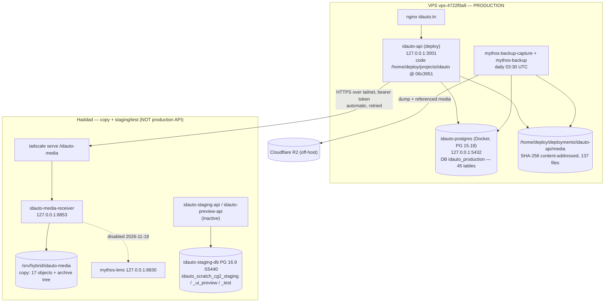

# IDauto — complete data architecture (inventory, 2026-11-19)

> Entry point for the read-only infrastructure audit of 2026-11-19 (UTC). Every fact was read from the **running** VPS and Haddad (systemd, Docker, PostgreSQL catalogues, `find`/`stat`/`file`/`findmnt`, tailscale serve status), not from older documentation. Nothing was modified, restarted, migrated, backed up or restored. Secrets, connection strings and document contents are not reproduced.

| Report | Contents |
|---|---|
| [DATABASE_INVENTORY.md](DATABASE_INVENTORY.md) | The 5 IDauto databases, engines, ports, containers, data directories, service → database map, migration history |
| [DATABASE_TABLES.md](DATABASE_TABLES.md) | All 45 production tables: every column, type, nullability, default, PK/FK/UNIQUE/CHECK, index, row count, size; sequences |
| [DATABASE_RELATIONSHIPS.md](DATABASE_RELATIONSHIPS.md) | 78 foreign keys by domain, logical (non-FK) links, records without a vehicle, Mermaid ER diagram |
| [STORAGE_INVENTORY.md](STORAGE_INVENTORY.md) | Every directory on both machines with owner/mode, file count, size, filesystem, backup, user; file categories; MIME by content |
| [VPS_HADDAD_ARCHITECTURE.md](VPS_HADDAD_ARCHITECTURE.md) | What runs where, how media reaches Haddad, LENS access, authoritative source per category |
| [BACKUP_INVENTORY.md](BACKUP_INVENTORY.md) | Scheduled and manual backups, last success, restore tests, retention, gaps |

## 1. One-page picture

## 2. Service → database → storage

| Service | Machine | Environment | Database | Storage written |
|---|---|---|---|---|
| `idauto-api` | VPS | Production | `idauto_production` @ 127.0.0.1:5432 | `/home/deploy/deployments/idauto-api/media` |
| `mythos-backup-capture` / `mythos-backup` | VPS | Production backup | `idauto_production` (read, `pg_dump`) | `/home/deploy/mythos-backups/*`, `/var/backups/mythos`, R2 |
| `idauto-media-receiver` | Haddad | Production copy | none | `/srv/hybrid/idauto-media` |
| `idauto-staging-api` (inactive) | Haddad | Staging | `idauto_scratch_cg2_staging` @ :55440 | `~/.local/share/idauto-staging/media` |
| `idauto-preview-api` (inactive) | Haddad | Preview | `idauto_scratch_ui_preview` @ :55440 | `~/.local/share/idauto-preview/media` |
| test suites | Haddad | Test | `idauto_scratch_test` @ :55440 | `~/.local/share/idauto-testenv/media` |
| `mythos-lens` | Haddad | LENS (separate project) | its own store | its own; IDauto access disabled |

## 3. Separation of environments

- **Production** exists only on the VPS: one database (`idauto_production`), one media store, one API.
- **Staging, preview, test** exist only on Haddad, on a separate PostgreSQL 16 cluster (port 55440) with separate roles and separate media directories. Local test instances do not have `IDAUTO_HADDAD_MEDIA_*` set in their env files, so they cannot push to the live receiver.
- **Legacy / dormant** on the VPS: database `idauto` (empty), `/home/deploy/deployments/idauto-media` (Aug 2026), `media-test-final`, `idauto-staging/` (old VPS staging, `staging.idauto.tn` nginx site, no running unit).

## 4. Verified facts vs unknown

**Verified live:** every database name, engine version, port, container/unit, data directory; all 45 table definitions and row counts; 78 FKs; every directory's owner, mode, count, size and filesystem; MIME types by content; the media → Haddad path (env names, tailscale mapping, replica rows); LENS disabled; backup schedule, last success and restore-test timestamps.

**Unknown / UNVERIFIED:**

1. Origin of the 129 unreferenced August-2026 objects in the production media store (not opened).
2. Why Haddad holds 17 objects while production records 8 replicas (9 extra; all dated 2026-11-16/18).
3. Remote (R2) retention policy and bucket-side lifecycle rules: not inspected (the credentials would be needed).
4. Which migration file was applied when: there is no migration table; only deploy records and PRs say so.
5. Firewall rules on either machine: not inspected (out of scope for a read-only data audit).

## 5. Findings to decide on (no action taken)

| # | Finding | Report |
|---|---|---|
| 1 | VPS root disk 97 % full; production database, media and all local backups share it | STORAGE, BACKUP |
| 2 | Haddad media copy has no backup; R2 is the only off-host copy | BACKUP |
| 3 | No migration-history table in production | DATABASE_INVENTORY |
| 4 | Duplicate FKs on `idauto_verifications` | DATABASE_INVENTORY |
| 5 | Legacy database `idauto` and legacy/test media directories still present | DATABASE_INVENTORY, STORAGE |
| 6 | Credential text files beside the deployment (mode 600) | STORAGE |
| 7 | Staging database lacks Update 6 schema; production PG 15 vs test PG 16 | DATABASE_INVENTORY |
| 8 | Scheduled restore test is monthly | BACKUP |
