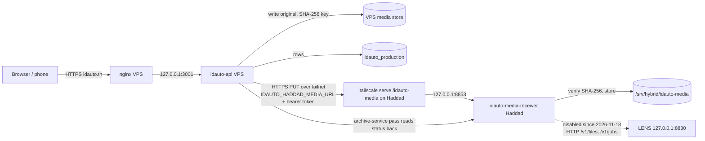

# IDauto — VPS and Haddad separation

> Read-only audit, 2026-11-19 (UTC). Every statement is from the running systems (units, listening sockets, env-file variable names, tailscale serve status, database rows) unless marked UNVERIFIED.

## 1. At a glance

| | VPS (`vps-4722f0a9`) | Haddad (`haddad`) |
|---|---|---|
| Role for IDauto | **Production**: serves idauto.tn | **Copy of media** + staging/preview/test + LENS |
| Production IDauto API | **Yes** — `idauto-api.service` (user `deploy`), node `reference/api.js`, 127.0.0.1:3001, behind nginx `idauto.tn` | **No** |
| Database | `idauto_production` in Docker `idauto-postgres` (PostgreSQL 15.18, 127.0.0.1:5432) | `idauto-staging-db` (PostgreSQL 16.9, 127.0.0.1:55440): `idauto_scratch_cg2_staging`, `idauto_scratch_ui_preview`, `idauto_scratch_test` — none production |
| Media | `/home/deploy/deployments/idauto-api/media` (authoritative) | `/srv/hybrid/idauto-media` (received copy) |
| Running IDauto services | `idauto-api` (active) | `idauto-media-receiver` (active, 127.0.0.1:8853); `idauto-staging-db` (active); `idauto-staging-api`, `idauto-preview-api` (inactive) |
| LENS | none | `mythos-lens.service`, 127.0.0.1:8830 (separate project) |
| Backups | daily DB dump + referenced media → Cloudflare R2 | no backup of the IDauto copy |

## 2. How files move from the VPS to Haddad

- **Transport:** HTTPS to `https://<haddad tailnet host>/idauto-media` (tailnet hostname not published) (tailnet only; `tailscale serve` maps `/idauto-media` → `http://127.0.0.1:8853`). Authenticated with a bearer token (`IDAUTO_HADDAD_MEDIA_TOKEN` on the VPS ↔ `IDAUTO_MEDIA_RECEIVER_TOKEN` on Haddad; values not reproduced). `IDAUTO_HADDAD_MEDIA_ADDR` is also set on the VPS (value not reproduced).
- **Automatic:** yes. The API queues each new object in `idauto_media_replicas` (`target='haddad'`) and an in-process worker pushes it with retries (`attempts`, `next_try_at`); `archive-service.pass()` files the archive record (`idauto_media_archive`) and reads back LENS status. Production state: 8 replicas `stored`, 6 archive rows `stored`, 0 pending/failed.
- **Copies, not originals:** the receiver stores a **copy**. The VPS keeps the original in its own store; the backup reads the VPS store, not Haddad.
- **No shared or remote-mounted storage.** `findmnt` shows both stores on local ext4 devices; no NFS/SSHFS/remote mount between the machines. The only link is the HTTPS push.
- **Direction:** VPS → Haddad only. There is no SSH from Haddad to the VPS for IDauto, and the receiver never writes back to the VPS.

## 3. LENS access

- LENS is reached **through its HTTP API** (`/v1/files`, `/v1/jobs`) by the Haddad receiver, never by reading the media directory directly; only the fields in the receiver's `LENS_FIELDS` allow-list (technical fields) are kept.
- **Currently disabled**: in `~/.config/idauto-media/receiver.env` both `IDAUTO_LENS_URL` and `IDAUTO_LENS_TOKEN_FILE` are commented out ("disabled 2026-11-18 by owner decision (LENS not integrated yet)"). Production archive rows show `lens_status = not_configured` for the newest carte grise and `needs_review` for older ones; the one intake document is `extraction_failed`.

## 4. Authoritative source per category

| Category | Authoritative | Copies |
|---|---|---|
| Vehicles, VIN, plates, IVID, documents metadata, users, audit log | `idauto_production` (VPS) | R2 daily dump; manual pre-deploy dumps (VPS) |
| Carte grise / vehicle photo originals | VPS media store | Haddad `/srv/hybrid/idauto-media`; R2 (referenced objects) |
| Archive date/place/source metadata | `idauto_media_archive` (VPS) | Haddad sidecars + `.archive-index` |
| LENS extraction results | `idauto_production` columns | — |
| Staging / preview / test data | Haddad cluster on :55440 | — |

## 5. Access boundaries (observed)

- `idauto-api` runs with `ProtectSystem=strict`, `ProtectHome=read-only`, `ReadWritePaths=` the media store only, `PrivateTmp=yes`, binding 127.0.0.1 only.
- Database ports: VPS 127.0.0.1:5432; Haddad 127.0.0.1:55440. Neither is exposed publicly.
- Haddad receiver: 127.0.0.1:8853, exposed only on the tailnet through `tailscale serve`.
- The Haddad preview (`:8443` tailnet → 127.0.0.1:8805) is tailnet-only and was stopped at audit time.
- Firewall rules were **not** inspected or changed in this audit.
